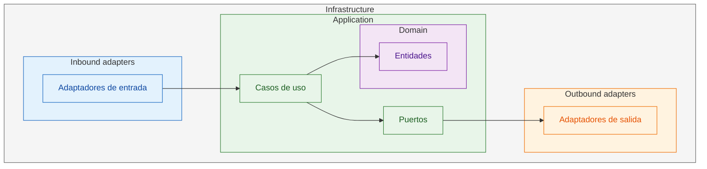

<UnderConstruction />

# Hexagonal Nest

<RepositoryLink href="https://github.com/paideia-code/paideia-poc-hexagonal-nest" />

`paideia-poc-hexagonal-nest` es una prueba de concepto educativa para aplicar [arquitectura hexagonal](/theory/diseno-arquitectura/arquitectura/arquitectura-interna/hexagonal/) a NestJS. El ejemplo modela una solicitud de inscripción de un estudiante a un curso y separa el dominio de HTTP, NestJS y la persistencia.

## Propósito y estado

La POC avanza en cuatro hitos:

1. Dominio de inscripciones.
2. Aplicación y caso de uso.
3. Adaptador de persistencia en memoria y composición mediante NestJS.
4. Entrada HTTP REST.

La persistencia actual es únicamente en memoria: al reiniciar la aplicación se pierde el estado. El repositorio contiene la documentación técnica completa, el código fuente y el test de dominio disponible actualmente.

## Relación con la teoría de arquitectura hexagonal

La [página teórica de arquitectura hexagonal](/theory/diseno-arquitectura/arquitectura/arquitectura-interna/hexagonal/) describe el principio general: el núcleo contiene la aplicación y sus reglas, los puertos expresan las dependencias y los adaptadores conectan el núcleo con el exterior. Esta POC es una implementación concreta de ese modelo:

| Teoría | Implementación en esta POC |
| --- | --- |
| Núcleo de dominio | `EnrollmentEntity`, `EnrollmentStatusValueObject` y las reglas de transición |
| Caso de uso | `RequestEnrollmentUseCase` |
| Puerto de entrada | El caso de uso que recibe `RequestEnrollmentCommand` |
| Puerto de salida | `EnrollmentRepositoryPort` |
| Adaptador de entrada | `EnrollmentsController`, DTOs y `ValidationPipe` de NestJS |
| Adaptador de salida | `InMemoryEnrollmentRepositoryAdapter` |
| Modelo externo de persistencia | `EnrollmentPersistenceRecord` |
| Composición | `EnrollmentModule` y el token de inyección del repositorio |

La dirección de las dependencias es la idea central: infraestructura → aplicación → dominio. El flujo de ejecución entra desde un adaptador, atraviesa el caso de uso y puede salir a través de otro adaptador; el dominio no conoce NestJS, HTTP, ORM ni una base de datos concreta.

Esta separación permite reemplazar el adaptador en memoria por una implementación SQL, NoSQL o un doble de prueba sin cambiar el caso de uso ni las reglas de `EnrollmentEntity`. También evita que un DTO HTTP o un modelo de persistencia se conviertan accidentalmente en modelos del dominio.

## Vista concéntrica

El siguiente diagrama representa los límites y las dependencias estáticas de la solución:



Las flechas muestran dependencias estáticas, no necesariamente el flujo temporal de una petición.

## Flujo de una solicitud de inscripción

Este es el flujo concreto desde HTTP hasta el adaptador de persistencia y de vuelta al cliente:

```mermaid
flowchart LR
    subgraph inbound[Inbound adapter]
        direction TB
        httpIn[HTTP request] --> requestDto[RequestEnrollmentDto]
        requestDto --> pipe[ValidationPipe]
        pipe --> controller[EnrollmentsController]
        resultDto[RequestEnrollmentResponseDto] --> httpOut[HTTP response]
        http400[HTTP 400]
        conflict[ConflictException]
        http409[HTTP 409]
        errorPolicy[Input error policy]
    end

    subgraph core[Core]
        direction TB
        subgraph application[Application]
            command[RequestEnrollmentCommand]
            useCase[RequestEnrollmentUseCase]
            duplicate[EnrollmentExistsActiveQuery]
            port["EnrollmentRepositoryPort<br/>existsActive(query)<br/>save(EnrollmentEntity): void"]
            result[RequestEnrollmentResult]
            activeError[RequestEnrollmentExistsActiveError]
        end

        subgraph domain[Domain]
            entity[EnrollmentEntity]
            status[EnrollmentStatusValueObject]
            transitionError[InvalidEnrollmentTransitionError]
        end
    end

    subgraph outbound[Outbound adapter]
        adapter[InMemoryEnrollmentRepositoryAdapter]
        record[EnrollmentPersistenceRecord]
    end

    controller --> command --> useCase
    useCase --> duplicate --> port
    port --> adapter
    adapter -->|duplicate check result| useCase
    useCase --> entity
    entity --> status
    useCase -->|save entity| port
    port -->|save| adapter
    adapter -->|map and store| record
    useCase --> result
    result --> resultDto
    pipe -->|invalid DTO| http400
    useCase -->|active enrollment found| activeError
    activeError -->|handled by controller| controller
    controller --> conflict --> http409
    entity -.->|invalid transition| transitionError
    transitionError -.-> errorPolicy

    classDef inboundStyle fill:#e8f1ff,stroke:#356ae6
    classDef applicationStyle fill:#fff4d6,stroke:#b7791f
    classDef domainStyle fill:#e8f8ed,stroke:#2f855a
    classDef outboundStyle fill:#f5e8ff,stroke:#805ad5
    classDef errorStyle fill:#fff0f0,stroke:#c53030
    classDef noteStyle fill:#f7fafc,stroke:#718096,stroke-dasharray: 5 5
    class httpIn,requestDto,pipe,controller,resultDto,httpOut,http400,conflict,http409,errorPolicy inboundStyle
    class command,useCase,duplicate,port,result,activeError applicationStyle
    class entity,status,transitionError domainStyle
    class adapter,record outboundStyle
    class activeError,transitionError,conflict,http400,http409 errorStyle
    class errorPolicy noteStyle
```



El adaptador de entrada valida el contrato HTTP y lo transforma en un command. El caso de uso consulta el puerto para detectar una inscripción activa, crea la entidad y la guarda a través del mismo puerto. El adaptador de salida mapea la entidad a un `EnrollmentPersistenceRecord`; ninguna de esas decisiones obliga al dominio a conocer el mecanismo de almacenamiento.

## Objetos y fronteras

| Objeto | Responsabilidad | Capa |
| --- | --- | --- |
| `RequestEnrollmentDto` | Validar y representar la entrada HTTP | Infrastructure, entrada |
| `RequestEnrollmentCommand` | Transportar la intención de solicitar una inscripción | Application |
| `RequestEnrollmentUseCase` | Orquestar la operación y sus reglas de aplicación | Application |
| `EnrollmentEntity` | Representar identidad, estado y reglas del dominio | Domain |
| `EnrollmentStatusValueObject` | Modelar los estados válidos de una inscripción | Domain |
| `EnrollmentExistsActiveQuery` | Describir el criterio de consulta | Application |
| `EnrollmentRepositoryPort` | Definir la dependencia de persistencia | Application, salida |
| `InMemoryEnrollmentRepositoryAdapter` | Implementar el puerto con memoria | Infrastructure, salida |
| `EnrollmentPersistenceRecord` | Representar el formato interno del adapter | Infrastructure |
| `RequestEnrollmentResult` | Transportar la salida del caso de uso | Application |
| `RequestEnrollmentResponseDto` | Representar la respuesta HTTP | Infrastructure, entrada |

La POC todavía no publica eventos de dominio; `EnrollmentRequested` sería una posible evolución cuando el ejemplo incorpore comunicación asíncrona.

## Estructura actual

```text
src/
├── main.ts
├── app.module.ts
└── enrollment/
    ├── enrollment.module.ts
    ├── application/
    │   ├── commands/request-enrollment-command.ts
    │   ├── errors/request-enrollment-exists-active-error.ts
    │   ├── ports/enrollment-repository-port.ts
    │   ├── query/enrollment-exists-active-query.ts
    │   ├── result/request-enrollment-result.ts
    │   ├── tokens/enrollment-repository.token.ts
    │   └── use-cases/request-enrollment-use-case.ts
    ├── domain/
    │   ├── entities/enrollment-entity.ts
    │   ├── errors/invalid-enrollment-transition-error.ts
    │   └── value-objects/enrollment-status-value-object.ts
    └── infrastructure/adapters/
        ├── inbound/
        │   ├── dto/
        │   │   ├── request-enrollment-dto.ts
        │   │   └── request-enrollment-response-dto.ts
        │   └── rest/enrollments.controller.ts
        └── outbound/persistence/
            ├── enrollment-persistence-record.ts
            └── in-memory-enrollment-repository-adapter.ts
```

## Ejecución y endpoint

Desde el directorio del repositorio:

```bash
npm install
npm run start:dev
```

La aplicación escucha en `PORT` o, si no está definido, en el puerto `3000`. El endpoint principal es:

```http
POST /enrollments
Content-Type: application/json

{
  "studentId": "student-1",
  "courseId": "course-1"
}
```

La entrada inválida produce `400`; una inscripción activa duplicada produce `409`.

Para consultar la lista completa de comandos, tests y responsabilidades por archivo, revisa el [README del repositorio en GitHub](https://github.com/paideia-code/paideia-poc-hexagonal-nest).

## Contenido relacionado

- [Arquitectura hexagonal](/theory/diseno-arquitectura/arquitectura/arquitectura-interna/hexagonal/): definición, aplicación, beneficios y trade-offs.
- [Inversión de dependencias](/theory/diseno-arquitectura/principios/mantenibilidad/inversion-dependencias/): principio que permite que el núcleo dependa de abstracciones.
- [Arquitectura Clean](/theory/diseno-arquitectura/arquitectura/arquitectura-interna/clean/): arquitectura relacionada con la separación entre políticas y mecanismos.
