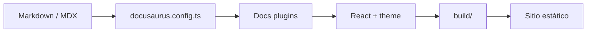

<UnderConstruction />

# Cómo funciona

El portal convierte documentos Markdown/MDX en un sitio estático mediante Docusaurus. El flujo general es:

## En desarrollo

Al ejecutar `npm run start`, Docusaurus inicia un servidor de desarrollo, lee la configuración y las instancias de documentación, transforma los archivos MDX y sirve las rutas resultantes. El navegador recibe la página y el bundle de React; los cambios en documentos o componentes se reflejan con recarga en vivo.

## En una compilación

`npm run build` procesa todo el contenido en modo producción:

1. Cada plugin de docs descubre sus archivos Markdown/MDX.
2. El front matter define metadatos, slugs y posiciones en el sidebar.
3. MDX se transforma en componentes React y se integra con el tema.
4. Docusaurus genera HTML estático, JavaScript, CSS y metadatos dentro de `build/`.

Por ejemplo, `docs/projects/paideia-code-site/estructura.mdx` se convierte en la ruta `/projects/paideia-code-site/estructura` (teniendo en cuenta el `baseUrl` durante el despliegue) y en un archivo HTML equivalente dentro de `build/projects/paideia-code-site/estructura/`.

El sitio final es estático: puede servirse desde un hosting de archivos. Aun así, los componentes React se hidratan en el navegador, por lo que `Quiz` puede mantener estado e interactuar después de cargar la página.

## Instancias de documentación

El portal usa una instancia de docs por sección para mantener rutas y sidebars independientes:

- **Theory** usa la instancia principal del preset clásico y publica `/theory`.
- **Templates** usa el plugin con id `templates` y publica `/templates`.
- **Libraries** usa el plugin con id `libraries` y publica `/libraries`.
- **POCs** usa el plugin con id `pocs` y publica `/pocs`.
- **Projects** usa el plugin con id `projects` y publica `/projects`.
- **Paideia Code Site** forma parte de la instancia `projects`, lee `docs/projects/paideia-code-site` y publica `/projects/paideia-code-site`.

Cada instancia puede tener su propio `sidebarPath`, mientras que el tema y los componentes MDX globales se comparten.
