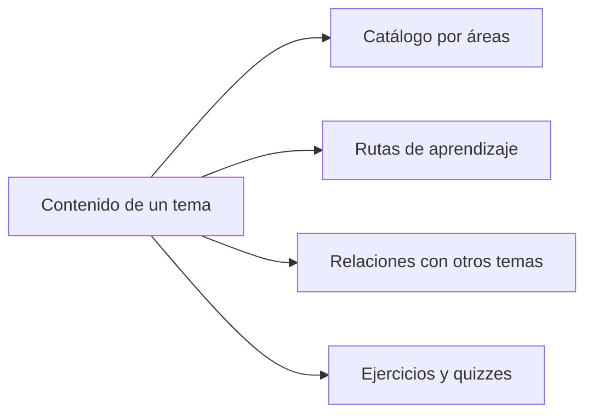

<ContentMeta area="Theory" type="guía de lectura" topics={['Conocimiento', 'Convenciones']} />

Theory organiza conocimiento de software e informática como una biblioteca que crece y como un conjunto de recorridos para estudiarla. Puedes consultar un tema directamente o seguir una ruta con prerrequisitos y práctica.

## Cómo estudiar una lección {#estudiar-una-leccion}

Comprende el problema, construye el modelo mental, sigue el ejemplo, practica y
revisa el resultado. Explica qué elegirías en un caso, qué condición cambiaría
tu decisión y cómo la comprobarías.

Una lección conceptual no exige ejecutar un laboratorio. Antes de continuar,
intenta explicar su objetivo con tus palabras y anota las dudas que necesiten
otro ejemplo.

## Un contenido, diferentes recorridos

Cada tema tiene una página principal. Sus conexiones permiten estudiarlo desde distintas áreas sin repetir la misma explicación. El orden de una ruta indica una secuencia de estudio; el catálogo organiza el conocimiento por áreas.

## Un lenguaje visual común

El color expresa la intención de un bloque. Su etiqueta y su título conservan el significado aunque no distingas el color.

<KnowledgeBlock kind="concept" title="Una idea que conviene comprender">
Una definición, un principio o una idea fundamental. Por ejemplo, una explicación de encapsulamiento puede separar una interfaz pública de las decisiones internas de implementación.
</KnowledgeBlock>

<KnowledgeBlock kind="model" title="Conectar las ideas">
Los modelos, diagramas y relaciones ayudan a ver cómo encajan los conceptos. Una conexión puede ser un prerrequisito, una ampliación, una aplicación o una comparación; no todas significan que debas leer primero la otra página.
</KnowledgeBlock>

<KnowledgeBlock kind="example" title="Observar un caso concreto">
Los ejemplos permiten seguir una idea sobre código, datos o una situación. Son casos acotados: examina sus supuestos antes de trasladarlos a otro problema.
</KnowledgeBlock>

<KnowledgeBlock kind="decision" title="Elegir con criterios">
Una comparación presenta alternativas, requisitos y consecuencias. La decisión debe poder explicarse a partir del caso y de sus restricciones.
</KnowledgeBlock>

<KnowledgeBlock kind="caution" title="Reconocer una condición importante">
Una precaución señala un límite o un riesgo que afecta al uso de una idea o una tecnología.
</KnowledgeBlock>

<KnowledgeBlock kind="error" title="Analizar una confusión">
Un error o contraejemplo muestra algo incorrecto para examinar por qué falla. El texto distingue el error de la explicación que lo corrige.
</KnowledgeBlock>

<KnowledgeBlock kind="check" title="Comprobar con evidencia">
Una comprobación describe qué observar para verificar un resultado. Su color no significa que ya hayas realizado la práctica.
</KnowledgeBlock>

## Qué dicen las etiquetas

El color depende de la función de la etiqueta, aunque cambie su posición o
no estén presentes todos los campos. El criterio se mantiene en claro y oscuro.

| Etiqueta | Presentación | Cómo interpretarla |
|---|---|---|
| Área o tema | Azul desaturado | Contexto del contenido: redes, algoritmos, AWS, entre otros |
| Nivel | Neutra, con «Nivel:» | Profundidad relativa del contenido; no es una valoración personal |
| Tipo o razonamiento | Violeta, con «Tipo:» | Lección, referencia o laboratorio; en preguntas, concepto, aplicación o análisis |
| Subtema | Neutra | Aspecto específico que desarrolla la página o pregunta |
| Número de respuestas | Neutra | Cuántas alternativas debes seleccionar; no identifica la solución |
| Contexto adicional | Neutra | Versión, certificación u otro contexto cuando sea pertinente |

El verde y el rojo de la corrección indican un resultado. No se utilizan para
calificar visualmente el nivel de dificultad.

## Diferentes formas de contenido

Las lecciones desarrollan un objetivo y ofrecen práctica. Los conceptos y patrones explican ideas y relaciones. Las referencias facilitan consultas rápidas. Los laboratorios proponen pasos y resultados comprobables. Las portadas ayudan a elegir por dónde continuar.

Una página breve no necesita incorporar todos los formatos ni un quiz artificial. El contenido determina qué recursos ayudan a comprenderlo.

## Contenido en construcción

Una página incompleta muestra un aviso de **sección en construcción** al inicio.
Los temas que solo están planificados pueden figurar sin enlace en un recorrido;
se incorporarán cuando se desarrolle su contenido.

## Cómo continuar

- Consulta [cómo practicar y usar los quizzes](./practica-y-quizzes).
- Explora [los contenidos de Theory](/theory/).
- Sigue el [recorrido de AWS](/theory/nube/aws/#programa).
