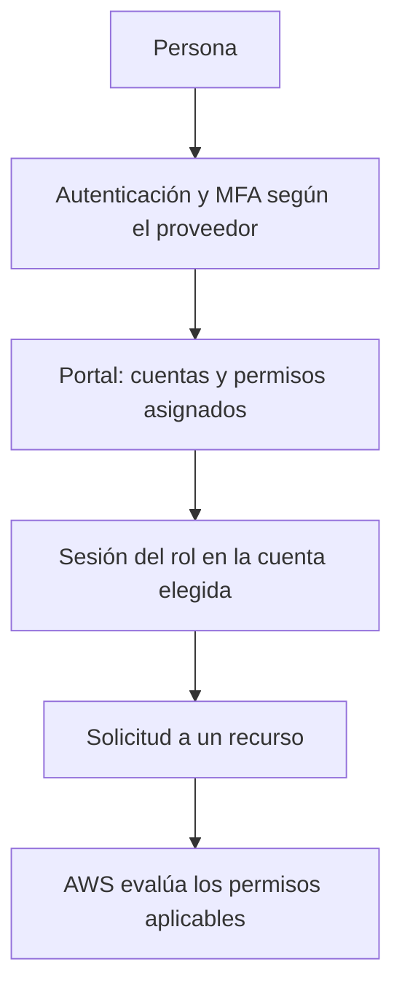

import {awsAccountAccess} from '@site/src/data/learning/aws';
import {awsAccountAccessBank} from './cuenta-aws-y-acceso-questions';

<ContentMeta area="AWS" level="básico" type="lección" topics={['Cuenta e IAM']} />

<KnowledgeBlock kind="check" title="Objetivo de la lección">
{awsAccountAccess.objective}
</KnowledgeBlock>

## 1. Cuenta, identidad y sesión

Una **cuenta AWS** agrupa recursos y administración de acceso. Una **identidad**
representa a quien actúa; una **credencial** permite demostrar esa identidad.
Una **sesión** es un contexto de acceso, normalmente limitado en el tiempo.
Compartir cuenta no exige compartir credenciales.

**IAM**, Identity and Access Management, controla el acceso a recursos AWS.
Conviene separar dos preguntas:

| Pregunta | Proceso | Qué demuestra |
|---|---|---|
| ¿Quién realiza la solicitud? | Autenticación | La identidad presentada |
| ¿Puede realizar esta operación? | Autorización | El permiso para esa acción y recurso |

Autenticarse correctamente no concede todas las operaciones. Una sesión puede
ser válida y recibir `AccessDenied` al intentar una acción no autorizada.
[Identidades y credenciales en IAM](https://docs.aws.amazon.com/IAM/latest/UserGuide/introduction_identity-management.html).

<KnowledgeBlock kind="example" title="Una cuenta, dos responsabilidades">
Una persona administra el acceso y otra consulta recursos de un entorno de pruebas.
Pueden trabajar en la misma cuenta con identidades y permisos distintos. Entregarles
una contraseña compartida impediría separar sus accesos y retirarlos individualmente.
</KnowledgeBlock>

## 2. Proteger el control de la cuenta

El **usuario raíz**, o *root user*, es la identidad de acceso inicial de una
cuenta. Tiene privilegios amplios y existen tareas específicas que requieren
su uso. Se reserva para esas tareas; el trabajo diario se realiza con otra identidad.

Para una cuenta independiente que administras:

1. Protege el correo asociado y sus mecanismos de recuperación.
2. Usa una contraseña única y registra MFA para el usuario raíz.
3. No crees claves de acceso programático de raíz.
4. Mantén accesibles los contactos y medios de recuperación autorizados.
5. Establece y prueba el acceso de trabajo antes de depender de él.

**MFA**, autenticación multifactor, añade un factor de verificación al inicio de
sesión. Una llave de seguridad o *passkey* compatible puede aportar resistencia
al phishing; protege también la recuperación del dispositivo o de la cuenta.

<KnowledgeBlock kind="caution" title="La recuperación también protege el acceso">
Una contraseña fuerte no basta si otra persona puede controlar el correo de
recuperación. Tampoco conviene dejar la recuperación dependiente de un único
dispositivo sin alternativa. Registra y custodia los medios admitidos según
la configuración de tu cuenta.
</KnowledgeBlock>

En organizaciones puede existir gestión centralizada del acceso raíz de cuentas
miembro. En una cuenta administrada por terceros, sigue su procedimiento; no
restablezcas ni crees credenciales de raíz como parte rutinaria de un laboratorio.
[Protección del usuario raíz](https://docs.aws.amazon.com/IAM/latest/UserGuide/root-user-best-practices.html).

## 3. Elegir identidad según quién trabaja

| Elemento | Qué representa | Uso y límite |
|---|---|---|
| Usuario raíz | Acceso inicial y tareas reservadas de la cuenta | No es la identidad de trabajo diario |
| Usuario de IAM Identity Center | Persona en un directorio de identidades | Accede mediante asignaciones a cuentas y permisos |
| Usuario IAM | Identidad persistente dentro de una cuenta | Puede tener contraseña o claves; no se elige por defecto para aplicaciones |
| Grupo IAM | Agrupación de usuarios IAM | Facilita asignar permisos; no inicia sesión ni asume roles |
| Rol IAM | Identidad asumible por principales autorizados | Se utiliza mediante sesiones con credenciales temporales |

**Federación** significa confiar en un sistema de identidad para permitir acceso
sin crear una contraseña IAM distinta para cada persona. IAM Identity Center
facilita el acceso de personas; una aplicación que llama a AWS utiliza su propio
mecanismo, como un rol asociado a su ejecución.

<KnowledgeBlock kind="model" title="Dos decisiones en un rol">
La confianza determina quién puede asumirlo. Los permisos determinan qué puede
hacer su sesión, sujetos a los demás controles aplicables. Confiar en alguien
para asumir un rol no concede por sí solo acceso a todos los recursos.
</KnowledgeBlock>

AWS recomienda federación para las personas y roles con credenciales temporales
para las cargas de trabajo. El mínimo privilegio consiste en conceder las
acciones y recursos necesarios para una tarea, y revisar ese alcance cuando cambia.
[Buenas prácticas de IAM](https://docs.aws.amazon.com/IAM/latest/UserGuide/best-practices.html).

<KnowledgeBlock kind="example" title="Una aplicación que lee objetos">
Una aplicación ejecutada en EC2 necesita leer un conjunto de objetos de S3.
Se le asocia un rol con los permisos necesarios; el entorno obtiene credenciales
temporales para sus llamadas. Copiar las claves personales de quien desplegó la
aplicación mezclaría dos responsabilidades y dificultaría retirar ese acceso.
</KnowledgeBlock>

## 4. Acceso de personas con IAM Identity Center

El **portal de acceso AWS** permite entrar en las cuentas asignadas. Un
**permission set**, o conjunto de permisos, define el acceso que Identity Center
aprovisiona mediante un rol en la cuenta de destino.



Hay dos tipos de instancia de Identity Center que no son intercambiables:

| Instancia | Alcance relevante para esta lección |
|---|---|
| De organización | Permite asignar acceso a cuentas AWS mediante conjuntos de permisos; se habilita desde la cuenta de administración de AWS Organizations |
| De cuenta | Atiende aplicaciones AWS compatibles; no ofrece conjuntos de permisos ni acceso a cuentas AWS |

Si ya tienes un portal de una organización, utiliza el acceso asignado. Para una
cuenta propia sin organización, revisa el procedimiento oficial de habilitación:
la vía de instancia de organización implica AWS Organizations. No confundas
crear una instancia de cuenta con preparar acceso a la consola de los servicios.

El MFA de las personas se configura en Identity Center o en el proveedor de
identidad utilizado; proteger raíz no lo configura para las demás identidades.
[Tipos de instancia y capacidades](https://docs.aws.amazon.com/singlesignon/latest/userguide/identity-center-instances.html).

### Secuencia de preparación

1. Identifica quién administra la cuenta y qué método de acceso existe.
2. Define la persona o grupo que necesita acceso y la cuenta de destino.
3. Asigna el conjunto de permisos requerido, con duración de sesión adecuada.
4. Configura MFA en el sistema que autentica a esa persona.
5. Prueba el portal, la cuenta y los permisos antes de iniciar una práctica.

Separar raíz de la identidad de trabajo mejora el control, pero **no reduce por
sí solo los privilegios**: una identidad con acceso administrativo sigue siendo
poderosa. No asignes administración general para resolver cualquier error de acceso.

## 5. Credenciales temporales y permanentes

Las credenciales temporales de AWS incluyen identificador de clave, clave secreta
y **token de sesión**; tienen vencimiento. AWS STS, Security Token Service,
participa en la emisión de estas credenciales. Un rol no equivale a una clave
secreta fija que deba copiarse a todas las aplicaciones.

| Propiedad | Credenciales temporales | Claves de un usuario IAM |
|---|---|---|
| Vigencia | Caducan | Permanecen hasta desactivación o eliminación |
| Obtención | Mediante un flujo de sesión autorizado | Mediante creación y distribución de las claves |
| Protección | Deben custodiarse durante su validez | Requieren custodia y gestión de su ciclo de vida |

La caducidad reduce la duración de una exposición; no vuelve inofensivo un secreto
filtrado. Durante su validez puede utilizarse dentro del alcance autorizado.
[Credenciales temporales](https://docs.aws.amazon.com/IAM/latest/UserGuide/id_credentials_temp.html).

## 6. Comprobar el acceso desde la CLI

La **AWS CLI** permite realizar llamadas desde una terminal. Un **perfil** agrupa
configuración local; su nombre no concede permisos. El acceso depende de las
credenciales que obtiene y de las asignaciones de la identidad.

Con AWS CLI v2 instalada y acceso de Identity Center ya asignado:

```powershell
aws configure sso --profile estudio
aws sso login --profile estudio
aws sts get-caller-identity --profile estudio
```

El asistente usa los datos de tu portal, la región de Identity Center y la cuenta
y rol disponibles. La región de Identity Center corresponde a su configuración;
no tiene por qué coincidir con la región de los recursos del laboratorio.
[Configuración SSO de la CLI](https://docs.aws.amazon.com/cli/latest/userguide/cli-configure-sso.html).

`get-caller-identity` devuelve `Account`, `Arn` y `UserId`: permite comprobar qué
cuenta e identidad están realizando la llamada. **No prueba permiso para leer
S3, crear instancias ni administrar IAM**. No requiere que se conceda un permiso
específico para esa operación.
[Referencia de GetCallerIdentity](https://docs.aws.amazon.com/cli/latest/reference/sts/get-caller-identity.html).

<KnowledgeBlock kind="example" title="El perfil correcto apunta a la cuenta incorrecta">
Un perfil llamado `estudio` puede haberse configurado con otra cuenta. El nombre
es una etiqueta local: verifica el identificador de cuenta y el ARN devueltos
antes de crear o modificar recursos. No intentes corregir la cuenta otorgando
más permisos a la sesión equivocada.
</KnowledgeBlock>

Una sesión vencida requiere renovar el acceso. Si la identidad es válida pero
una operación devuelve `AccessDenied`, comprueba cuenta, identidad y operación
solicitada antes de modificar permisos. Si hay varias fuentes de credenciales
configuradas, revisa cuál está usando la herramienta.

## 7. Comprobación antes del primer laboratorio

| Comprobación | Evidencia que buscar |
|---|---|
| Control de la cuenta | Raíz y recuperación protegidos según la administración de la cuenta |
| Identidad de trabajo | Acceso individual, cuenta de destino y alcance identificados |
| Sesión de la herramienta | Cuenta y ARN comprobados en la consola o con la CLI |
| Permisos necesarios | Operaciones de la práctica conocidas; no confundir autenticación con autorización |
| Consumo | Unidades facturadas, presupuesto y destinatarios de alertas revisados |
| Cierre | Recursos que se crearán, datos que conservar y procedimiento de retirada identificados |

Los presupuestos y sus alertas ayudan a observar el consumo; no son un límite
inmediato de gasto. Revisa los controles de la
[lección de costes](/theory/aws/fundamentos/costes-control-consumo) antes de crear recursos.

<KnowledgeBlock kind="check" title="Criterio para continuar">
Explica cómo conservarías el control de la cuenta, qué identidad usaría una
persona y cuál una aplicación. Describe qué comprueba una sesión válida y qué
permiso todavía habría que verificar antes de ejecutar una operación.
</KnowledgeBlock>

<div id="practica-y-quizzes">
  <QuizWorkbench bank={awsAccountAccessBank} />
</div>

## Para continuar

El siguiente tema es **políticas y mínimo privilegio**: expresar acciones,
recursos y condiciones, y comprobar el alcance concedido.
