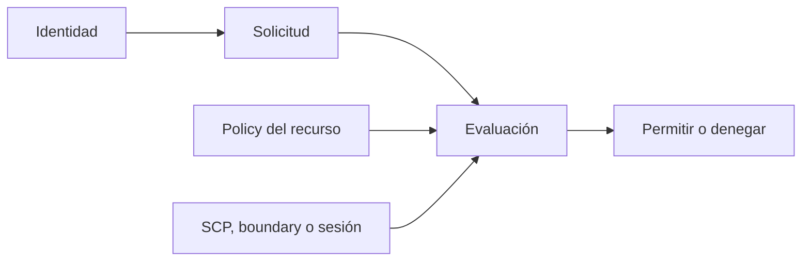
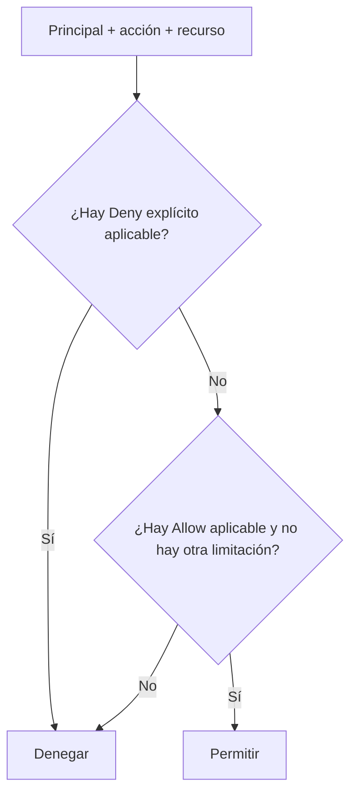

import {awsIamPoliciesBank} from './iam-politicas-y-permisos-questions';

<ContentMeta area="AWS" level="intermedio" type="lección" topics={['Cuenta e IAM']} />

<KnowledgeBlock kind="check" title="Objetivo de la lección">
Definir permisos acotados, distinguir las políticas que participan en una
solicitud y diagnosticar un `AccessDenied` sin resolverlo concediendo permisos
excesivos.
</KnowledgeBlock>

Las políticas expresan decisiones de autorización. Para comprenderlas hay que
seguir la solicitud completa: quién actúa, qué acción intenta realizar, sobre
qué recurso y bajo qué condiciones.

## 1. Una política describe una decisión

Una policy puede asociarse a una identidad, a un recurso o a una capa de control.
No es una lista abstracta de capacidades: cada sentencia intenta responder si
una solicitud concreta puede continuar.

```json
{
  "Version": "2012-10-17",
  "Statement": [
    {
      "Sid": "ReadCourseObjects",
      "Effect": "Allow",
      "Action": ["s3:GetObject"],
      "Resource": "arn:aws:s3:::NOMBRE_DEL_BUCKET/cursos/*"
    }
  ]
}
```

| Elemento | Pregunta que ayuda a responder |
|---|---|
| `Effect` | ¿La sentencia permite o deniega? |
| `Action` | ¿Qué operación del servicio se solicita? |
| `Resource` | ¿Sobre qué ARN se aplica? |
| `Principal` | ¿Qué identidad puede actuar? |
| `Condition` | ¿Qué contexto debe cumplirse? |
| `Sid` | ¿Cómo identificamos la intención de la sentencia? |

`Principal` es especialmente relevante en una resource policy y en una trust
policy. Una identity policy normalmente se adjunta a un usuario, grupo o rol,
por lo que la identidad asociada ya forma parte del contexto.
[Elementos de las políticas](https://docs.aws.amazon.com/IAM/latest/UserGuide/reference_policies_elements.html).

<KnowledgeBlock kind="example" title="Permiso concreto para un prefijo">
Una aplicación necesita leer objetos bajo `cursos/publicos/`. Un permiso
acotado especifica `s3:GetObject` y el ARN de los objetos de ese prefijo. No
necesita `s3:*`, acceso a todos los buckets ni permisos para administrar IAM.
</KnowledgeBlock>

## 2. Identidad, recurso y capas de control

Una **identity policy** se adjunta a una identidad. Una **resource policy** se
adjunta al recurso y puede expresar acceso desde otra cuenta cuando el servicio
lo permite. Ambas pueden participar en la autorización de una misma solicitud.



Además de las policies de identidad y recurso, pueden limitar el resultado:

| Capa | Qué delimita |
|---|---|
| SCP | El máximo que una cuenta miembro puede utilizar en Organizations |
| Permission boundary | El máximo que una identidad puede conceder o usar |
| Session policy | El alcance de una sesión concreta |
| VPC endpoint policy | Las solicitudes que pasan por un endpoint |
| Explicit Deny | Una denegación aplicable que prevalece sobre Allow |

Estas capas no se resuelven agregando otro `Allow` sin examinar el contexto.
[Lógica de evaluación](https://docs.aws.amazon.com/IAM/latest/UserGuide/reference_policies_evaluation-logic.html).

## 3. Mínimo privilegio como decisión revisable

El mínimo privilegio no consiste en escribir siempre una policy larga. Consiste
en conceder las acciones, recursos y condiciones que el trabajo necesita, y
revisar ese alcance cuando cambian el workload o sus dependencias.

| Dimensión | Pregunta de diseño |
|---|---|
| Acción | ¿La aplicación necesita leer, escribir, listar o administrar? |
| Recurso | ¿Qué ARN concreto debe alcanzar? |
| Condición | ¿Debe depender de tags, MFA, red, cuenta o contexto? |
| Duración | ¿El permiso pertenece a la sesión o al workload permanente? |
| Evidencia | ¿Qué uso real demuestra que sigue siendo necesario? |

<KnowledgeBlock kind="caution" title="Wildcard no significa automáticamente incorrecto">
`*` puede ser necesario en acciones o recursos con restricciones propias, pero
debe justificarse. Si se usa como solución rápida para un `AccessDenied`, se
convierte en una ampliación sin evidencia y puede ocultar un ARN o servicio
incorrecto.
</KnowledgeBlock>

IAM Access Analyzer puede ayudar a revisar acceso externo y políticas. La
herramienta apoya el análisis; no sustituye entender la operación que el sistema
necesita realizar.
[IAM Access Analyzer](https://docs.aws.amazon.com/IAM/latest/UserGuide/what-is-access-analyzer.html).

## 4. Cómo se evalúa una solicitud

La evaluación parte de una denegación implícita. Una sentencia `Allow` aplicable
puede conceder la operación, pero una sentencia `Deny` explícita aplicable
prevalece.



No hay que confundir autenticación con autorización. Que `get-caller-identity`
identifique correctamente la cuenta demuestra quién realiza la llamada, pero no
demuestra que esa identidad pueda leer S3, crear una instancia o modificar IAM.

## 5. Diagnosticar `AccessDenied`

Un diagnóstico útil reduce el caso a una solicitud concreta antes de cambiar
políticas:

1. Identificar el principal efectivo con `sts get-caller-identity`.
2. Registrar la acción, el recurso, la cuenta y la región de la llamada.
3. Revisar las policies de identidad y recurso aplicables.
4. Buscar SCP, boundary, session policy o endpoint policy.
5. Comprobar ARN, condiciones, nombres y permisos dependientes.
6. Usar CloudTrail para confirmar la llamada y su contexto.

<KnowledgeBlock kind="example" title="Un Allow que no alcanza">
Una role policy permite `s3:GetObject` en un bucket. La llamada continúa
fallando. Antes de ampliar permisos, se comprueba si el ARN apunta a otro
objeto, si una bucket policy contiene un Deny, si existe una SCP restrictiva y
si la aplicación está usando realmente el rol esperado.
</KnowledgeBlock>

<KnowledgeBlock kind="check" title="Criterio de comprobación">
Una policy está justificada cuando puedes nombrar el principal, la operación,
el recurso y la evidencia que demuestra la necesidad. Una policy que solo
funciona porque concede administración general requiere revisión.
</KnowledgeBlock>

<div id="practica-y-quizzes">
  <QuizWorkbench bank={awsIamPoliciesBank} />
</div>

## Para continuar

[IAM: roles y credenciales](/theory/nube/aws/02-seguridad/01-iam/03-roles-y-credenciales).
