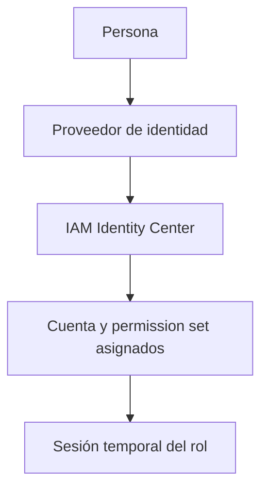

import {awsIamRolesBank} from './iam-roles-y-credenciales-questions';

<ContentMeta area="AWS" level="intermedio" type="lección" topics={['Cuenta e IAM']} />

<KnowledgeBlock kind="check" title="Objetivo de la lección">
Distinguir confianza y permisos, preferir credenciales temporales y asignar roles
separados a personas, servicios y pipelines según la responsabilidad que cumplen.
</KnowledgeBlock>

Un rol no es una contraseña compartida. Es una identidad que un principal
autorizado puede asumir durante una sesión. La trust policy responde quién puede
asumirlo; las policies de permisos responden qué puede hacer esa sesión.

## 1. Credenciales permanentes y temporales

Las access keys de un usuario IAM son credenciales de larga duración. Pueden ser
necesarias en casos concretos, pero su distribución añade custodia, rotación y
riesgo de filtración.

STS puede emitir credenciales temporales al asumir un rol. El conjunto incluye
identificador de clave, clave secreta y token de sesión, y expira según la sesión.

| Propiedad | Credenciales temporales | Access keys de usuario IAM |
|---|---|---|
| Vigencia | Caducan | Permanecen hasta desactivación o eliminación |
| Uso habitual | Workloads, federación y sesiones | Casos heredados o herramientas concretas |
| Gestión | Renovar mediante un flujo autorizado | Custodiar, rotar y retirar manualmente |
| Riesgo | Ventana limitada, sin eliminar el riesgo | Exposición potencial más prolongada |

La caducidad reduce la duración de una exposición; no vuelve inofensivo un
secreto filtrado durante su validez.
[Credenciales temporales](https://docs.aws.amazon.com/IAM/latest/UserGuide/id_credentials_temp.html).

<KnowledgeBlock kind="model" title="Dos decisiones distintas en un rol">
La relación de confianza determina quién puede obtener una sesión. La policy de
permisos determina qué puede hacer esa sesión. Una trust policy amplia no debe
compensarse con permisos amplios, ni una policy de permisos debe usarse para
decidir quién asume el rol.
</KnowledgeBlock>

## 2. Cómo se asume un rol


El principal puede ser una persona federada, un servicio AWS, una identidad de
otra cuenta o un proveedor OIDC. La autorización efectiva sigue considerando
las demás capas: resource policies, SCP, permission boundaries y condiciones.

## 3. Roles de servicio y workloads

Cada plataforma tiene un punto donde obtiene credenciales para el código que
ejecuta. La responsabilidad de ese rol debe quedar separada de la preparación
del workload.

| Contexto | Rol o mecanismo | Responsabilidad principal |
|---|---|---|
| EC2 | Instance profile | Entregar credenciales temporales a procesos de la instancia |
| ECS/Fargate | Task role | Permisos que necesita el código de la aplicación |
| ECS/Fargate | Task execution role | Descargar imágenes, publicar logs y arrancar la tarea |
| Lambda | Execution role | Permisos que usa la función durante su ejecución |
| CI/CD | Rol federado | Permisos del pipeline para construir o desplegar |

<KnowledgeBlock kind="example" title="Task role y execution role">
Una tarea ECS necesita descargar una imagen y enviar logs, mientras que el
código necesita leer objetos S3. El execution role cubre el arranque de la tarea;
el task role cubre la operación de la aplicación. Mezclarlos concede al código
permisos que solo eran necesarios para la plataforma.
</KnowledgeBlock>

AWS recomienda que el código no reciba access keys personales ni claves escritas
en variables de configuración. El entorno debe obtener credenciales mediante el
mecanismo de roles de su plataforma.
[Roles para servicios AWS](https://docs.aws.amazon.com/IAM/latest/UserGuide/id_roles_common-scenarios_services.html).

## 4. Personas y federación

Para personas, IAM Identity Center o un proveedor de identidad federado permite
asignar acceso sin crear una contraseña IAM por cada usuario de trabajo. El
permission set se aprovisiona como un rol en la cuenta de destino.



La federación resuelve autenticación y asignación de acceso; no elimina la
necesidad de revisar el alcance de las policies.
[IAM Identity Center](https://docs.aws.amazon.com/singlesignon/latest/userguide/what-is.html).

## 5. CI/CD con OIDC

Un pipeline externo puede federarse con AWS mediante OIDC. El proveedor presenta
claims del workflow y una trust policy decide qué repositorio, rama, entorno o
workflow puede asumir el rol.

| Diseño | Consecuencia |
|---|---|
| OIDC + rol limitado | Sesiones temporales y confianza condicionada |
| Access key compartida como secret | Credencial persistente y difícil de atribuir |
| Rol común de administrador | Radio de impacto excesivo ante un fallo del pipeline |

<KnowledgeBlock kind="caution" title="La confianza también necesita mínimo privilegio">
Permitir que cualquier repositorio de una organización asuma un rol de despliegue
puede ser demasiado amplio. Restringe las condiciones al repositorio, rama o
entorno que realmente debe desplegar.
</KnowledgeBlock>

[Proveedor OIDC para GitHub Actions](https://docs.github.com/en/actions/deployment/security-hardening-your-deployments/configuring-openid-connect-in-cloud-providers).

## 6. Separar responsabilidades entre servicios

Un rol por workload ayuda a limitar el radio de impacto y a atribuir las
operaciones. La separación no exige crear un rol por cada función mínima si dos
componentes tienen exactamente la misma responsabilidad y ciclo de vida, pero
debe existir una razón explícita para compartirlo.

<KnowledgeBlock kind="example" title="Dos microservicios y S3">
`content-service` necesita escribir objetos y `course-service` solo consulta
metadatos. Sus roles deben expresar esas necesidades por separado. Si ambos
comparten un rol con escritura, una vulnerabilidad en el segundo servicio puede
usar un permiso que no necesita.
</KnowledgeBlock>

## 7. Comprobar una identidad de workload

Antes de diagnosticar una llamada, identifica la cuenta y el ARN que realmente
están actuando. El nombre local del perfil, del contenedor o del pipeline no
demuestra qué rol obtuvo la sesión.

```powershell
aws sts get-caller-identity
```

Después relaciona el ARN con la trust policy, las policies del rol y el recurso
que se intenta utilizar. Una identidad correcta puede seguir recibiendo
`AccessDenied` si sus permisos no cubren la operación.
[GetCallerIdentity](https://docs.aws.amazon.com/cli/latest/reference/sts/get-caller-identity.html).

<KnowledgeBlock kind="check" title="Criterio de comprobación">
Para cada workload puedes explicar quién asume el rol, qué permisos necesita,
cuándo expiran sus credenciales y qué evidencia usarías para verificar la
identidad efectiva.
</KnowledgeBlock>

<div id="practica-y-quizzes">
  <QuizWorkbench bank={awsIamRolesBank} />
</div>

## Para continuar

[Evaluación de permisos y diagnóstico](/theory/aws/iam/evaluacion-de-permisos-y-diagnostico).
