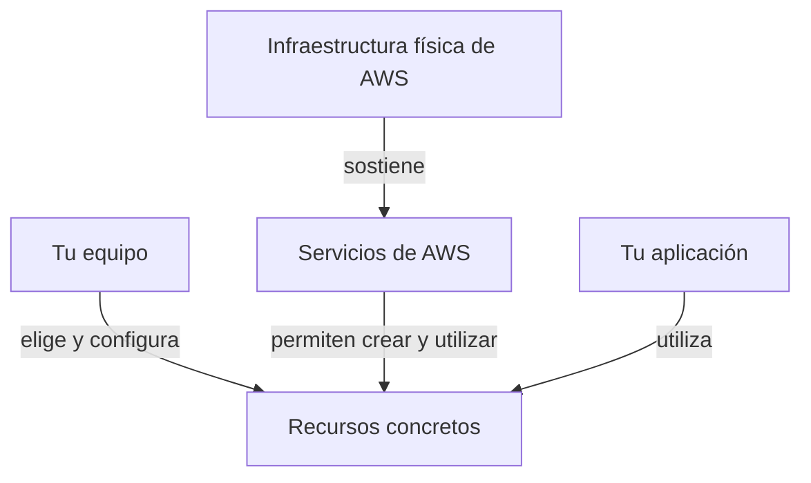

import {awsIntro} from '@site/src/data/learning/aws';
import {awsCloudBank} from './cloud-computing-questions';

<ContentMeta area={awsIntro.area} level={awsIntro.level} type={awsIntro.kind} topics={awsIntro.topics} />

<KnowledgeBlock kind="check" title="Objetivo de la lección">
{awsIntro.objective}
</KnowledgeBlock>

## 1. Obtener capacidad para una aplicación

Ejecutar software requiere cómputo, almacenamiento y comunicaciones. Operar
infraestructura propia implica adquirir equipos, instalarlos y mantenerlos.
Cuando cambia la demanda, hay que decidir cuánta capacidad disponer y cuándo.
Cloud modifica la forma de obtener esas capacidades y repartir su gestión.

## 2. Qué significa cloud computing

<KnowledgeBlock kind="concept" title="Recursos tecnológicos bajo demanda">
Cloud computing permite obtener recursos tecnológicos como servicios de un proveedor, con facturación según las condiciones de consumo de cada servicio.
</KnowledgeBlock>

AWS proporciona capacidades de cómputo, almacenamiento, bases de datos y otras tecnologías sobre infraestructura que mantiene el proveedor. Tú solicitas y configuras lo que necesitas. [Definición oficial de AWS](https://docs.aws.amazon.com/whitepapers/latest/aws-overview/what-is-cloud-computing.html).

**Bajo demanda** significa poder solicitar recursos cuando los necesitas, sin comprar e instalar personalmente cada servidor físico. Esto permite experimentar y ajustar capacidad con mayor rapidez. [Ventajas del modelo cloud](https://docs.aws.amazon.com/whitepapers/latest/aws-overview/six-advantages-of-cloud-computing.html).

Pasas de adquirir y operar toda la infraestructura física a consumir capacidades que el proveedor ofrece como servicios.

## 3. El mapa mental

La aplicación sigue necesitando cómputo, almacenamiento y comunicaciones. Lo que cambia es **cómo obtienes esas capacidades y quién mantiene cada parte**.

## 4. Servicio y recurso

Un **servicio** ofrece una capacidad. Un **recurso** es una entidad concreta con la que trabajas. AWS identifica como recursos, por ejemplo, una instancia EC2 o un bucket S3. [Recursos en AWS](https://docs.aws.amazon.com/ARG/latest/userguide/resource-groups.html).

<KnowledgeBlock kind="example" title="Precisar el alcance">
«Uso S3» identifica el servicio. «Configuré los permisos del bucket de fotografías» identifica un recurso y una decisión sobre él.
</KnowledgeBlock>

Usaremos **aprovisionar** para referirnos a preparar recursos y configurarlos para utilizarlos.

## 5. Cuánto delegas: IaaS, PaaS y SaaS

Estas categorías permiten comparar niveles de gestión:

| Modelo | Qué recibes | En qué se concentra tu equipo |
|---|---|---|
| IaaS · Infraestructura como servicio | Máquinas virtuales, almacenamiento y red | Sistema operativo, software instalado y operación de la aplicación |
| PaaS · Plataforma como servicio | Plataforma para desplegar aplicaciones con infraestructura subyacente gestionada | Código, configuración y datos de la aplicación |
| SaaS · Software como servicio | Aplicación operada por el proveedor | Uso y configuración disponible del producto |

Son categorías orientativas: hay que revisar el control y las responsabilidades del servicio concreto. [Modelos de servicio según AWS](https://aws.amazon.com/types-of-cloud-computing/).

<KnowledgeBlock kind="decision" title="Comparar control y trabajo operativo">
Al evaluar alternativas, identifica qué necesita controlar el equipo y qué tareas quiere delegar. Esa comparación debe responder al caso y sus restricciones.
</KnowledgeBlock>

## 6. Modelo de responsabilidad compartida {#responsabilidad-compartida}

AWS denomina este reparto **modelo de responsabilidad compartida**:

<KnowledgeBlock kind="example" title="Reparto según el servicio">

| Servicio utilizado | AWS mantiene | Tu equipo conserva |
|---|---|---|
| EC2 convencional administrada por tu equipo | Infraestructura física y virtualización | Sistema operativo invitado, parches, software instalado y configuración de acceso |
| S3 | Infraestructura y plataforma de almacenamiento, incluido su sistema operativo | Gestión de los datos y configuración de permisos |

El reparto depende del servicio. [Modelo de responsabilidad compartida](https://aws.amazon.com/compliance/shared-responsibility-model/).

</KnowledgeBlock>

<KnowledgeBlock kind="model" title="La pregunta que repetiremos">
Al elegir este servicio, ¿qué tareas delegamos y cuáles debemos seguir resolviendo?
</KnowledgeBlock>

## 7. Dos confusiones que conviene evitar

<KnowledgeBlock kind="error" title="«Si está en AWS, aumentará su capacidad automáticamente»">
Poder obtener capacidad y haber configurado un mecanismo para ajustarla son decisiones distintas. Un Auto Scaling Group mantiene una capacidad deseada; sus políticas pueden modificarla dentro de los límites configurados. [Capacidad de Auto Scaling](https://docs.aws.amazon.com/autoscaling/ec2/userguide/asg-capacity-limits.html).
</KnowledgeBlock>

<KnowledgeBlock kind="caution" title="Pago por uso: identifica qué se está midiendo">
Una instancia EC2 en ejecución puede generar cargos aunque permanezca ociosa. En ese caso consumes capacidad de cómputo aunque no lleguen solicitudes. [Estados y facturación de EC2](https://docs.aws.amazon.com/AWSEC2/latest/UserGuide/ec2-instance-lifecycle.html).
</KnowledgeBlock>

## 8. Comprobar la comprensión

Al cerrar la lección deberías poder explicar el cambio a recursos bajo demanda, distinguir servicio y recurso, comparar niveles de gestión y reconocer responsabilidades que conserva tu equipo.

  <QuizWorkbench bank={awsCloudBank} />

## Para continuar

Continúa con [infraestructura global: regiones y zonas de disponibilidad](/theory/aws/fundamentos/infraestructura-global).
También puedes consultar el [programa de estudio](/theory/nube/aws/#programa).
