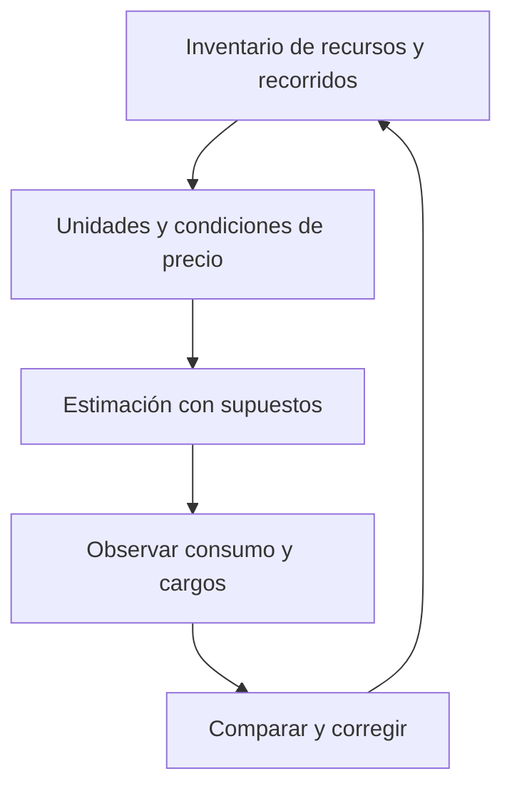

import {awsCosts} from '@site/src/data/learning/aws';
import {awsCostsBank} from './costes-control-consumo-questions';

<ContentMeta area="AWS" level="básico" type="lección" topics={['Fundamentos']} />

<KnowledgeBlock kind="check" title="Objetivo de la lección">
{awsCosts.objective}
</KnowledgeBlock>

## 1. Del recurso al cargo

Para interpretar el coste hay que identificar qué servicio se utiliza, qué
unidad factura, cuánto se consume y qué condiciones se aplican. El número de
visitas no representa por sí solo todo el consumo de una aplicación.

| Dimensión | Qué revisar |
|---|---|
| Cómputo | Tiempo, tamaño o capacidad aprovisionada, según el servicio |
| Almacenamiento | Cantidad conservada, clase y operaciones aplicables |
| Solicitudes y procesamiento | Operaciones y unidades procesadas |
| Transferencia | Origen, destino, dirección y recorrido de los datos |
| Servicios auxiliares | Red, observabilidad, copias y otros recursos asociados |

Las unidades, tarifas y condiciones dependen del servicio y de la región.
Consultar la [página oficial de precios](https://aws.amazon.com/pricing/) forma
parte de la estimación; no debe sustituirse por una tarifa memorizada.

## 2. Estimar con supuestos visibles

Una estimación es un modelo, no una factura garantizada. Debe registrar período,
unidades, carga prevista, ubicación, recursos permanentes y supuestos de crecimiento.

<KnowledgeBlock kind="example" title="Un cálculo de alcance limitado">
Con una tarifa hipotética de 0,10 unidades monetarias por hora y dos recursos
durante 100 horas, el componente de tiempo suma 20 unidades monetarias.

El cálculo excluye almacenamiento, red y otros cargos. No es una tarifa de AWS
ni una estimación completa. Si el tiempo real duplica el supuesto, ese componente
también se duplica mientras se mantengan las demás condiciones.
</KnowledgeBlock>

Una estimación útil separa un escenario habitual de otro de mayor consumo e
identifica las variables con más incertidumbre.
[AWS Pricing Calculator](https://calculator.aws/).

## 3. Modalidades y compromisos

| Modalidad conceptual | Qué comparar | Precaución |
|---|---|---|
| Consumo sin compromiso de duración | Flexibilidad y unidad aplicable | No implica coste cero cuando no hay solicitudes |
| Descuento con compromiso | Consumo estable elegible y obligación adquirida | El descuento no garantiza ahorro si el compromiso no se aprovecha |
| Capacidad interrumpible | Compatibilidad del trabajo con interrupciones | No es equivalente a capacidad que debe mantenerse sin interrupción |

AWS ofrece modalidades como On-Demand, Savings Plans y opciones de capacidad
Spot. Sus condiciones y cobertura deben revisarse por producto. No todas las
modalidades aplican a todos los servicios ni son intercambiables.
[Principios de precios de AWS](https://aws.amazon.com/pricing/).

## 4. Observar y atribuir el consumo

| Herramienta o señal | Uso | Límite |
|---|---|---|
| Facturación | Revisar cargos y período facturado | No sustituye identificar el recurso y su causa |
| Cost Explorer | Analizar costes y uso por dimensiones | Los datos de costes no equivalen a telemetría instantánea |
| Etiquetas de asignación de costes | Relacionar consumo con un proyecto o responsable | Deben gestionarse y habilitarse según sus condiciones |
| Métricas operativas | Relacionar demanda y recursos utilizados | Una métrica de actividad no siempre es la unidad facturada |

Para investigar una diferencia, compara cuenta, región, servicio, período,
cantidad, precio aplicable y recursos que no estaban incluidos en el inventario.
[Ayuda de facturación y análisis de cargos](https://docs.aws.amazon.com/awsaccountbilling/latest/aboutv2/billing-get-answers.html).

<KnowledgeBlock kind="example" title="Poco tráfico con recursos permanentes">
Una API deja de recibir solicitudes, pero mantiene cómputo, discos y copias
aprovisionados. El tráfico bajo no demuestra que todos esos componentes hayan
dejado de generar cargos. Hay que revisar el estado y la unidad de cada uno.
</KnowledgeBlock>

## 5. Presupuestos, alertas y acciones

Un presupuesto expresa un objetivo de coste o uso y permite observar su
evolución. Las alertas pueden referirse a valores reales o previstos. También
existen acciones configurables, cuyo alcance debe comprobarse.

<KnowledgeBlock kind="caution" title="Un aviso no es un corte inmediato">
La información de consumo y las notificaciones pueden llegar con retraso.
Configurar un umbral no garantiza detener todo recurso ni impedir superar esa
cantidad. Una acción sobre aprovisionamiento tampoco elimina necesariamente
cargos de recursos existentes.
</KnowledgeBlock>

[AWS Budgets](https://docs.aws.amazon.com/cost-management/latest/userguide/budgets-managing-costs.html)
documenta el seguimiento, las acciones y los posibles retrasos. Hay que verificar
destinatarios, permisos, alcance y comportamiento esperado de cada control.

## 6. Cuotas, límites configurados y presupuesto

| Concepto | Qué limita o expresa | Qué no demuestra |
|---|---|---|
| Cuota de servicio | Cantidad o tasa permitida en su ámbito | Que el consumo permitido sea gratuito |
| Límite configurado por el equipo | Una política o capacidad objetivo concreta | Que abarque todos los servicios y cargos |
| Presupuesto | Un objetivo económico o de uso | Que exista un techo inmediato para toda la cuenta |

Las cuotas pueden tener alcance de cuenta, región o recurso. Algunas permiten
solicitar aumentos; su aprobación y tiempo de gestión no deben darse por hechos.
[AWS Service Quotas](https://docs.aws.amazon.com/servicequotas/latest/userguide/intro.html).

<KnowledgeBlock kind="example" title="Tres controles distintos">
Un grupo tiene un máximo deseado de seis instancias; una cuota limita otra
cantidad aplicable al servicio; un presupuesto avisa al alcanzar cierto gasto.
Son controles con unidades y alcances diferentes. Ninguno permite deducir por
sí solo el importe final de toda la aplicación.
</KnowledgeBlock>

## 7. Retirar recursos con criterio

Antes de eliminar un recurso, identifica qué debe conservarse y qué depende de
él. Después revisa los recursos asociados: detener una unidad de cómputo no
demuestra la retirada de discos, copias, direcciones o servicios de red.

| Momento | Comprobación |
|---|---|
| Antes | Inventario, propietario, datos que conservar y dependencias |
| Durante | Estado real de cada recurso y resultado de las operaciones de retirada |
| Después | Recursos residuales y evolución posterior de cargos |

Eliminar datos necesarios para bajar una factura no es una optimización segura.
Reducir capacidad debe respetar los objetivos del servicio y la recuperación.

## 8. Dónde buscar ayuda

Para un cargo inesperado, reúne cuenta, servicio, región, período y evidencia
de uso, sin compartir secretos. Distingue problemas de cuenta o facturación de
consultas técnicas sobre recursos. Los canales y condiciones del soporte técnico
dependen del plan vigente; revísalos en la documentación oficial.
[Ayuda con facturas y pagos](https://docs.aws.amazon.com/awsaccountbilling/latest/aboutv2/billing-get-answers.html).

<KnowledgeBlock kind="check" title="Explicar una estimación y sus controles">
Identifica las unidades relevantes, declara los supuestos y explica cómo detectarías
una desviación. Distingue alertar, limitar aprovisionamiento y retirar recursos,
y describe qué verificarías después.
</KnowledgeBlock>

  <QuizWorkbench bank={awsCostsBank} />

## Para continuar

Continúa con [Cuenta AWS y acceso inicial](/theory/aws/iam/acceso-inicial):
proteger el control de la cuenta y separar las identidades de trabajo.
