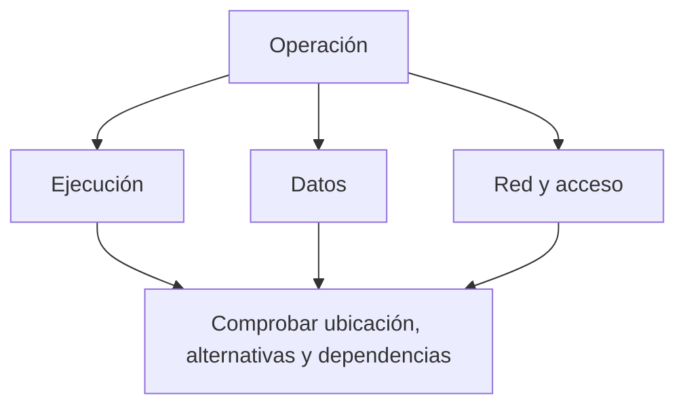

import {awsAvailability} from '@site/src/data/learning/aws';
import {awsAvailabilityBank} from './disponibilidad-tolerancia-fallos-questions';

<ContentMeta area="AWS" level="básico" type="lección" topics={['Fundamentos']} />

<KnowledgeBlock kind="check" title="Objetivo de la lección">
{awsAvailability.objective}
</KnowledgeBlock>

## 1. Definir qué debe seguir funcionando

La disponibilidad describe en qué medida un sistema permite completar sus
operaciones cuando se necesitan. Para evaluarla hay que definir la operación,
qué cuenta como éxito, desde dónde se observa y durante qué período.

Un proceso encendido no demuestra que una operación funcione: puede esperar una
dependencia inaccesible, rechazar solicitudes o responder fuera del tiempo aceptable.

| Concepto | Pregunta que responde |
|---|---|
| Disponibilidad | ¿Puede completarse la operación bajo sus condiciones de servicio? |
| Alta disponibilidad | ¿Qué diseño y mecanismos reducen las interrupciones? |
| Tolerancia a fallos | ¿Qué fallos especificados puede soportar el sistema manteniendo el servicio requerido? |
| Recuperación | ¿Cómo se restablecen servicio y datos después de una interrupción? |

La tolerancia debe vincularse a un escenario concreto. Ningún número de réplicas
demuestra resistencia a todos los fallos posibles.
[Continuidad y recuperación en AWS](https://docs.aws.amazon.com/whitepapers/latest/disaster-recovery-workloads-on-aws/high-availability-is-not-disaster-recovery.html).

## 2. Medir con un criterio explícito

Se puede medir disponibilidad por tiempo de servicio o por proporción de
solicitudes satisfactorias. Son mediciones distintas: no deben mezclarse sin
declarar el criterio. También importan las operaciones y ubicaciones incluidas.

<KnowledgeBlock kind="example" title="Un cálculo acotado">
En un ejercicio con observación continua de 30 días, se considera indisponible
una operación durante 43,2 minutos. La disponibilidad temporal es 99,9 %:
el tiempo observado tiene 43 200 minutos y la interrupción representa 0,1 %.

Ese porcentaje no indica si ocurrió un único incidente largo o varios cortos.
Tampoco equivale a un compromiso contractual de AWS.
</KnowledgeBlock>

Un **SLO** es un objetivo de nivel de servicio que guía el diseño y la evaluación.
Un **SLA** es un acuerdo de servicio con condiciones propias. Antes de usar un
porcentaje, hay que revisar su alcance y sus reglas de medición.

## 3. Localizar puntos únicos de fallo

Un punto único de fallo es un componente o dependencia cuya pérdida impide
completar la operación y para el que no existe una alternativa utilizable.

| Revisión | Qué buscar |
|---|---|
| Cómputo | Réplicas útiles y capacidad restante tras un fallo |
| Datos | Disponibilidad de lectura/escritura y comportamiento de recuperación |
| Red y acceso | Rutas, resolución de nombres y permisos necesarios |
| Cambios | Errores de configuración o software que pueden afectar varias réplicas |

<KnowledgeBlock kind="example" title="Dos réplicas con una dependencia común">
Dos instancias de una API están en AZ distintas, pero ambas necesitan un almacén
único en una de ellas. Si el almacén queda inaccesible, la otra instancia puede
seguir ejecutándose sin completar las consultas.

La separación del cómputo reduce una dependencia zonal de esa capa; no elimina la
dependencia de datos. Hay que seguir la operación completa.
</KnowledgeBlock>

## 4. Redundancia y conmutación

La redundancia ofrece componentes o copias adicionales. Para aprovecharla se
necesita detectar el fallo, seleccionar una alternativa preparada y dirigirle
el trabajo. **Failover**, o conmutación ante fallos, es ese cambio hacia una alternativa.

| Patrón conceptual | Funcionamiento | Qué comprobar |
|---|---|---|
| Activo/activo | Varias unidades atienden trabajo | Reparto, estado compartido y capacidad después del fallo |
| Activo/pasivo | Una alternativa espera su activación | Detección, preparación, cambio y tiempo de recuperación |

Las comprobaciones de salud deben reflejar la función esperada del componente.
Una detección equivocada puede mantener un destino inservible o retirar uno sano.
Los reintentos requieren límites y una estrategia compatible con la operación;
repetir indiscriminadamente puede aumentar la carga durante un incidente.

<KnowledgeBlock kind="caution" title="Una alternativa debe poder utilizarse">
Revisa su capacidad, acceso a datos, configuración y permisos. Una réplica que
existe pero no puede asumir el trabajo no demuestra continuidad.
</KnowledgeBlock>

Distribuir entre AZ aprovecha aislamiento físico; distribuir entre regiones
añade otra separación y complejidad de datos, coordinación y recuperación.
[Servicios regionales y dependencias](https://docs.aws.amazon.com/whitepapers/latest/aws-fault-isolation-boundaries/regional-services.html).

## 5. Replicación, respaldo y recuperación

| Mecanismo | Propósito | Límite |
|---|---|---|
| Replicación | Mantener copias que acompañan cambios | Puede propagar borrados o corrupción |
| Respaldo | Conservar un estado recuperable | Hay que poder restaurarlo y disponer de lo necesario para usarlo |
| Recuperación ante desastres | Restablecer la carga ante un incidente de gran alcance | Requiere objetivos, procedimientos y comprobaciones |

Alta disponibilidad y recuperación ante desastres comparten mecanismos, pero no
son equivalentes. Una copia que replica un borrado no sustituye un respaldo
recuperable anterior al borrado.
[AWS: alta disponibilidad y recuperación](https://docs.aws.amazon.com/whitepapers/latest/disaster-recovery-workloads-on-aws/high-availability-is-not-disaster-recovery.html).

## 6. Objetivos de recuperación

**RTO** expresa cuánto tiempo de interrupción se considera aceptable hasta
restablecer el servicio. **RPO** expresa la pérdida de datos aceptable medida
como separación temporal respecto del estado anterior al incidente.
Son objetivos; no prueban lo que el sistema consigue realmente.
[Objetivos de recuperación](https://docs.aws.amazon.com/whitepapers/latest/disaster-recovery-of-on-premises-applications-to-aws/recovery-objectives.html).

<KnowledgeBlock kind="example" title="Tiempo de servicio y antigüedad de los datos">
Un ejercicio exige recuperar el servicio en 30 minutos y perder como máximo
5 minutos de cambios. RTO y RPO son, respectivamente, 30 y 5 minutos.

Si se restaura en 20 minutos usando una copia de hace una hora, se cumple el
tiempo de recuperación, pero no el objetivo de pérdida de datos.
</KnowledgeBlock>

## 7. Comprobar la recuperación

| Paso | Evidencia necesaria |
|---|---|
| Definir el escenario | Fallo de proceso, ubicación, datos o cambio defectuoso |
| Establecer el alcance | Operaciones y dependencias afectadas |
| Ejecutar el procedimiento en un entorno controlado | Detección, cambio, restauración y permisos disponibles |
| Medir | Tiempo, datos recuperados, errores y capacidad restante |
| Corregir | Diferencias entre el objetivo y el resultado observado |

<KnowledgeBlock kind="check" title="Justificar una afirmación de continuidad">
Elige una operación, identifica qué fallo debe soportar y explica qué alternativa
la mantiene o la recupera. Distingue la configuración prevista de la evidencia
obtenida al comprobarla.
</KnowledgeBlock>

  <QuizWorkbench bank={awsAvailabilityBank} />

## Para continuar

[Costes y control del consumo](/theory/aws/fundamentos/costes-control-consumo).
