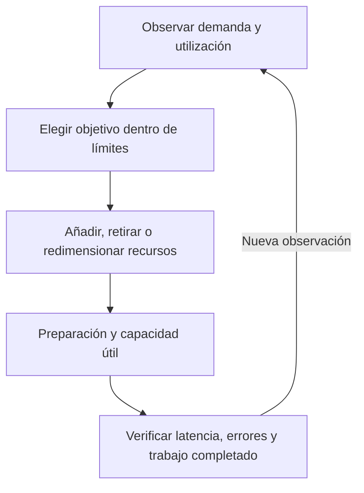

import {awsScaling} from '@site/src/data/learning/aws';
import {awsScalingBank} from './escalabilidad-elasticidad-questions';

<ContentMeta
  area={awsScaling.area}
  level={awsScaling.level}
  type={awsScaling.kind}
  topics={awsScaling.topics}
/>

<KnowledgeBlock kind="check" title="Objetivo de la lección">
{awsScaling.objective}
</KnowledgeBlock>

Como base, conviene distinguir servicio de recurso y reconocer los límites de
aislamiento y dependencias que desarrolla
[infraestructura global](/theory/aws/fundamentos/infraestructura-global).

## 1. Demanda, capacidad y resultado

Un sistema recibe trabajo y dispone de recursos para procesarlo. Cuando la
demanda cambia, necesitamos decidir si ajustar esa capacidad y comprobar el efecto.

| Concepto | Qué describe | Cómo observarlo |
|---|---|---|
| Demanda | Trabajo que llega al sistema | Solicitudes por segundo, tareas entrantes o usuarios concurrentes |
| Capacidad | Recursos y trabajo que el sistema puede procesar bajo determinadas condiciones | Número y tamaño de réplicas, concurrencia permitida y resultados de pruebas de carga |
| Resultado | Servicio que recibe quien utiliza el sistema | Latencia, operaciones completadas, errores y cumplimiento del objetivo |

La **latencia** es el tiempo que tarda una operación. Su promedio puede ocultar
solicitudes lentas. El **percentil 95, p95**, sitúa aproximadamente al 95 % de las
observaciones de un período en ese valor o por debajo; el resto puede tardar más.
No es el promedio ni el máximo.
[Estadísticas de CloudWatch](https://docs.aws.amazon.com/AmazonCloudWatch/latest/monitoring/Statistics-definitions.html).

La capacidad no es una cifra universal asociada al número de servidores. Depende
del trabajo, del software y de sus dependencias. AWS recomienda observar demanda
y utilización en lugar de adivinar la capacidad necesaria.
[Principios de fiabilidad](https://docs.aws.amazon.com/wellarchitected/latest/framework/rel-dp.html).

## 2. Escalabilidad y elasticidad

<KnowledgeBlock kind="concept" title="Dos propiedades relacionadas">
**Escalabilidad** es la capacidad de un sistema para afrontar más trabajo al
ajustar sus recursos y su diseño, manteniendo los objetivos de servicio.

**Elasticidad** es la capacidad de ajustar los recursos a necesidades variables:
obtenerlos cuando hacen falta y liberarlos cuando dejan de ser necesarios. En
cloud se busca automatizar ese ajuste.
</KnowledgeBlock>

| Pregunta | Propiedad que estamos evaluando |
|---|---|
| ¿Puede el sistema atender más trabajo al aumentar capacidad? | Escalabilidad |
| ¿Ajusta la capacidad cuando la demanda sube y cuando baja? | Elasticidad |

Un aumento aislado demuestra un cambio de capacidad; no basta para acreditar un
ajuste sostenido a la demanda. La automatización necesita métricas, decisiones y
límites apropiados al sistema.
[Elasticidad en AWS](https://docs.aws.amazon.com/whitepapers/latest/reactive-systems-on-aws/elastic.html),
[adaptación a la demanda](https://docs.aws.amazon.com/wellarchitected/latest/framework/rel-07.html).

## 3. Escalado vertical y horizontal

| Dirección | Aumento | Reducción | Qué debe permitir el sistema |
|---|---|---|---|
| Vertical | Más recursos por unidad: scale up | Menos recursos por unidad: scale down | Usar el nuevo tamaño y tolerar el procedimiento de cambio |
| Horizontal | Más unidades de ejecución: scale out | Menos unidades: scale in | Repartir trabajo y añadir o retirar réplicas de forma segura |

El cambio de tamaño puede tener límites y requerir interrupciones según la
tecnología. Añadir réplicas exige que el trabajo pueda distribuirse; tampoco
elimina los límites de las dependencias compartidas.

La dirección del cambio y su automatización son decisiones distintas: un ajuste
horizontal puede ser manual, programado o gobernado por métricas.

<KnowledgeBlock kind="example" title="Cambiar tamaño o cantidad">
Una aplicación puede pasar de un servidor de menor capacidad a otro con más CPU
y memoria: es un ajuste vertical. También puede pasar de dos réplicas equivalentes
a cuatro: es un ajuste horizontal.

En una instancia EC2 respaldada por EBS, el procedimiento documentado para
cambiar el tipo de la instancia existente requiere detenerla. Ese caso ilustra
por qué hay que comprobar el procedimiento, su compatibilidad y la interrupción
prevista; no atribuir el mismo comportamiento a todas las tecnologías.
[Cambio de tipo de instancia](https://docs.aws.amazon.com/AWSEC2/latest/UserGuide/change-instance-type-of-ebs-backed-instance.html).
</KnowledgeBlock>

## 4. Automatizar un ajuste necesita un ciclo de control

<KnowledgeBlock kind="model" title="Observar, actuar y verificar">
La automatización transforma señales en decisiones de capacidad. El objetivo
de la decisión no equivale al estado real ni al resultado recibido por el usuario.
</KnowledgeBlock>

| Forma de decidir | Cuándo resulta útil | Qué comprobar |
|---|---|---|
| Manual | Una intervención concreta o un ajuste conocido | Que el cambio se ejecute y consiga el resultado esperado |
| Programada | Variaciones previsibles por horario | Preparación anticipada y ajuste si el patrón real cambia |
| Reactiva | Variaciones observadas mediante métricas | Relación entre señal, capacidad y resultado; tiempo de respuesta |

Las acciones programadas y las políticas basadas en métricas pueden combinarse.
Un horario por sí solo no comprueba que la demanda real coincida con la prevista.
[Escalado programado](https://docs.aws.amazon.com/autoscaling/ec2/userguide/ec2-auto-scaling-scheduled-scaling.html).

## 5. Métricas para decidir y métricas para verificar

| Qué observar | Para qué sirve | Límite de la conclusión |
|---|---|---|
| Solicitudes o tareas entrantes | Entender cuánto trabajo llega | Más tráfico no identifica por sí solo el componente limitante |
| CPU, memoria, E/S y utilización por réplica | Examinar saturación y reparto | Un promedio puede ocultar desequilibrios y otras esperas |
| Trabajo pendiente y tiempo de espera | Detectar acumulación de trabajo | Hay que relacionarlo con la capacidad de procesamiento |
| Latencia y errores | Evaluar el resultado del servicio | Una degradación puede venir de una dependencia, no de falta de réplicas |

La señal que gobierna un ajuste debe responder de forma útil al cambio de
capacidad. No toda métrica que detecta un problema sirve directamente para
cualquier política de escalado.

<KnowledgeBlock kind="example" title="Elegir una señal para target tracking">
En EC2 Auto Scaling, una política de seguimiento de objetivo —target tracking—
requiere una métrica de utilización adecuada. El promedio de solicitudes por
destino puede servir si refleja la carga de cada réplica. El total de solicitudes
recibidas por el balanceador no disminuye necesariamente al añadir instancias.

La latencia ayuda a verificar el resultado, pero no tiene necesariamente una
relación proporcional con el número de réplicas. No debe trasladarse sin análisis
a una política que exija esa relación.
[Métricas para seguimiento de objetivo](https://docs.aws.amazon.com/autoscaling/ec2/userguide/as-scaling-target-tracking.html).
</KnowledgeBlock>

## 6. Objetivo, límites y capacidad útil

Una configuración de capacidad expresa una intención. Aprovisionar recursos,
preparar la aplicación y estabilizar su funcionamiento lleva tiempo. Por eso
debemos distinguir capacidad objetivo, recursos ya iniciados y capacidad que
realmente puede atender el trabajo esperado.

<KnowledgeBlock kind="example" title="Mínimo, deseado y máximo en un Auto Scaling Group">

En este ejemplo, las unidades son instancias equivalentes:

| Configuración | Valor | Interpretación |
|---|---|---|
| Mínimo | 2 | Límite inferior de la capacidad deseada bajo estos controles |
| Deseado | 4 | Objetivo que el grupo intenta mantener |
| Máximo | 8 | Límite superior de la capacidad deseada para los ajustes descritos |

Sin políticas ni acciones que cambien el objetivo, el grupo intenta mantener
cuatro. El máximo no ordena crear ocho ni reserva esa capacidad. Si una instancia
se pierde y se reemplaza para recuperar cuatro, se mantiene el objetivo: esa
acción no demuestra un ajuste por aumento de demanda.

Estas cifras no describen un estado real instantáneo garantizado. Los recursos
pueden estar iniciándose, preparándose o retirándose.
[Límites y capacidad deseada](https://docs.aws.amazon.com/autoscaling/ec2/userguide/asg-capacity-limits.html).

Un balanceador distribuye tráfico entre destinos; Auto Scaling gestiona la
cantidad de instancias según la configuración. Pueden integrarse, pero cumplen
funciones diferentes.
[Integración con Elastic Load Balancing](https://docs.aws.amazon.com/autoscaling/ec2/userguide/autoscaling-load-balancer.html).

</KnowledgeBlock>

<KnowledgeBlock kind="caution" title="El ajuste no es instantáneo">
Una política necesita observar la señal y ejecutar el cambio. Después, la
aplicación debe estar preparada para atender trabajo. Evaluar únicamente el
objetivo solicitado puede ocultar ese intervalo sin capacidad útil suficiente.
</KnowledgeBlock>

En EC2 Auto Scaling, el **warmup** permite estabilizar la contribución de nuevas
instancias a las métricas agregadas. No equivale por sí solo a comprobar que la
aplicación está preparada: las comprobaciones de salud y las tareas de
inicialización cumplen otras funciones.
[Warmup de instancias](https://docs.aws.amazon.com/autoscaling/ec2/userguide/ec2-auto-scaling-default-instance-warmup.html).

Para evitar oscilaciones —añadir y retirar repetidamente ante variaciones
breves— hay que adecuar las ventanas de observación y los tiempos de
estabilización al mecanismo elegido. Una retirada demasiado agresiva puede
dejar capacidad insuficiente antes de que el siguiente aumento esté preparado.

## 7. Qué puede limitar el escalado horizontal

| Aspecto | Pregunta de diseño |
|---|---|
| Reparto de trabajo | ¿Las réplicas reciben trabajo de forma aprovechable? |
| Estado de sesión o datos locales | ¿Otra réplica puede continuar sin perder información necesaria? |
| Dependencias compartidas | ¿El almacén, la red u otro servicio soportan la carga adicional? |
| Concurrencia | ¿Procesar más operaciones simultáneas conserva la corrección? |
| Retirada de una réplica | ¿Qué ocurre con solicitudes o tareas que todavía están en curso? |

Una aplicación **sin estado local imprescindible entre solicitudes** puede
reemplazar o añadir réplicas con mayor flexibilidad. Esto no significa que carezca
de datos: el estado necesario puede mantenerse fuera de la réplica, y ese
almacenamiento introduce sus propias dependencias.
[Diseñar sistemas sin estado cuando sea posible](https://docs.aws.amazon.com/wellarchitected/latest/framework/rel_mitigate_interaction_failure_stateless.html).

<KnowledgeBlock kind="example" title="Más réplicas sin mejora del resultado">
Una API tiene CPU baja y tarda principalmente en esperar consultas a un almacén
saturado. Se duplican las réplicas de la API y la latencia no mejora.

El cambio aumentó la capacidad de una capa sin resolver el límite observado.
Incluso puede elevar la presión sobre el almacén. El siguiente paso es comprobar
la dependencia y el efecto de la concurrencia, no repetir el aumento sin evidencia.
</KnowledgeBlock>

## 8. Reducir capacidad también forma parte del diseño

La retirada exige decidir cuándo dejar de asignar trabajo y cómo terminar,
conservar o recuperar el que está en curso. Una utilización baja no demuestra
que una réplica pueda apagarse inmediatamente sin consecuencias.

<KnowledgeBlock kind="example" title="Una tarea larga durante scale in">
Un trabajador procesa una tarea y solo conserva su progreso en memoria. Se retira
antes de finalizar y ese progreso se pierde. El diseño debe decidir si la tarea
puede completarse antes de retirarlo o si existe un mecanismo adecuado de
recuperación o repetición.

El caso no atribuye una garantía de procesamiento a un servicio concreto. En
EC2 Auto Scaling existen mecanismos del ciclo de vida para coordinar tareas de
preparación y retirada; hay que configurar el comportamiento necesario.
[Lifecycle hooks](https://docs.aws.amazon.com/autoscaling/ec2/userguide/lifecycle-hooks.html).
</KnowledgeBlock>

Al evaluar elasticidad, verifica tanto el aumento como la reducción. Mantener
capacidad ociosa después de un pico puede perder parte del beneficio del ajuste;
retirarla sin protección puede degradar el servicio.

## 9. Comparar demanda y capacidad con un modelo acotado

<KnowledgeBlock kind="example" title="Estimación de réplicas bajo supuestos explícitos">
Supongamos un modelo didáctico: cada réplica preparada procesa 30 solicitudes
por segundo con el objetivo de servicio elegido, el trabajo se reparte de manera
uniforme y las dependencias no limitan. Se conserva como mínimo una réplica.

| Momento | Demanda | Réplicas estimadas | Comprobación |
|---|---|---|---|
| Inicial | 90 solicitudes/s | 3 | Comprobar latencia, errores y reparto |
| Pico | 210 solicitudes/s | 7 | Disponer de las nuevas réplicas preparadas a tiempo |
| Descenso | 90 solicitudes/s | 3 | Retirar con seguridad la capacidad que ya no hace falta |

La estimación divide demanda por capacidad por réplica y redondea hacia arriba.
Si el límite configurado permite solo seis, este modelo no puede cubrir el pico.

Las cifras y la suma lineal son supuestos del ejercicio, no garantías de
rendimiento de AWS. En un sistema real hay que medir el comportamiento y sus
dependencias antes de extrapolar resultados.
</KnowledgeBlock>

## 10. Errores frecuentes

| Afirmación | Qué revisar |
|---|---|
| «Escalable significa que se ajusta automáticamente» | Capacidad de crecer, dirección y automatización son propiedades distintas |
| «Más réplicas siempre reducen la latencia» | Localizar el límite y comprobar las dependencias |
| «El máximo es la capacidad ya disponible» | Separar límite, objetivo y estado real |
| «Un objetivo más alto ya aporta capacidad útil» | Considerar aprovisionamiento, preparación y tiempos de respuesta |
| «CPU baja permite retirar cualquier réplica» | Revisar trabajo en curso y estado necesario |
| «Escalar horizontalmente demuestra tolerancia a fallos» | Comprobar ubicación y dependencias, además de cantidad |

## 11. Criterio para continuar

<KnowledgeBlock kind="check" title="Justificar y verificar un ajuste">
Explica si una necesidad exige cambiar tamaño, cantidad o diseño. Elige una
señal útil y un objetivo, distingue lo deseado de lo preparado y describe cómo
verificarías el resultado al aumentar y reducir capacidad.
</KnowledgeBlock>

  <QuizWorkbench bank={awsScalingBank} />

## Referencias oficiales

- [Elasticidad](https://docs.aws.amazon.com/whitepapers/latest/reactive-systems-on-aws/elastic.html).
- [Principios de fiabilidad](https://docs.aws.amazon.com/wellarchitected/latest/framework/rel-dp.html).
- [Capacidad deseada y límites](https://docs.aws.amazon.com/autoscaling/ec2/userguide/asg-capacity-limits.html).
- [Seguimiento de objetivo y métricas](https://docs.aws.amazon.com/autoscaling/ec2/userguide/as-scaling-target-tracking.html).
- [Warmup](https://docs.aws.amazon.com/autoscaling/ec2/userguide/ec2-auto-scaling-default-instance-warmup.html).
- [Estado de la aplicación](https://docs.aws.amazon.com/wellarchitected/latest/framework/rel_mitigate_interaction_failure_stateless.html).

## Para continuar

[Disponibilidad y tolerancia a fallos](/theory/aws/fundamentos/disponibilidad-tolerancia-fallos).
