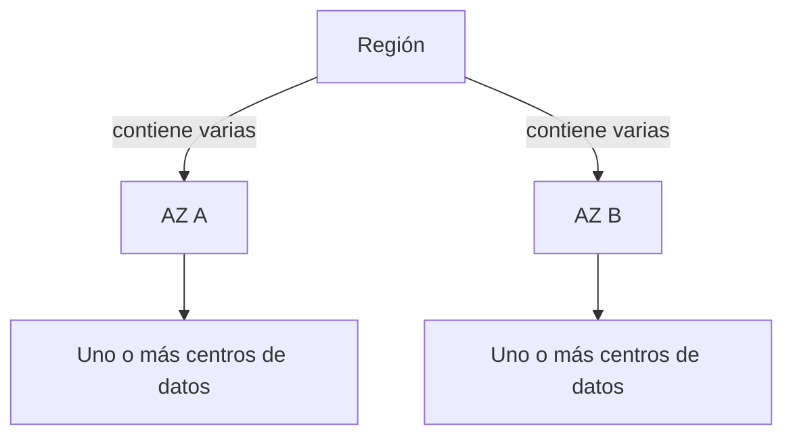

import {awsInfrastructure} from '@site/src/data/learning/aws';
import {awsInfrastructureBank} from './infraestructura-global-questions';

<ContentMeta
  area={awsInfrastructure.area}
  level={awsInfrastructure.level}
  type={awsInfrastructure.kind}
  topics={awsInfrastructure.topics}
/>

<KnowledgeBlock kind="check" title="Objetivo de la lección">
{awsInfrastructure.objective}
</KnowledgeBlock>

Como base, conviene distinguir servicio de recurso y reconocer que delegar
infraestructura conserva decisiones de configuración y operación.
Puedes revisar [cloud computing](/theory/nube/aws/01-fundamentos/01-conceptos-cloud) si necesitas retomar esas ideas.

## 1. Por qué importa la ubicación

Al desplegar software necesitamos decidir dónde ejecutar los componentes y
conservar sus datos. Esa ubicación influye en las comunicaciones y en qué
incidentes podrían afectar simultáneamente a los recursos.

La infraestructura global se estudia desde dos preguntas: **dónde ubicar los
recursos** y **qué límites de aislamiento proporciona esa distribución**.

## 2. Región, zona de disponibilidad y centro de datos

| Concepto | Qué representa | Qué permite analizar |
|---|---|---|
| Región — Region | Área geográfica con infraestructura organizada en varias AZ | Ubicación regional de recursos y datos |
| Zona de disponibilidad — Availability Zone, AZ | Ubicación físicamente separada dentro de una región, formada por uno o más centros de datos | Distribución entre ubicaciones de fallo distintas |
| Centro de datos — data center | Instalación física con equipos de cómputo, almacenamiento y red | Infraestructura que sostiene los servicios |

AWS conecta las AZ de una región con redes de baja latencia y mantiene separación
en elementos como alimentación eléctrica y conectividad. La separación busca
reducir fallos compartidos entre zonas. Una AZ puede contener varios centros de
datos. [AWS: zonas de disponibilidad](https://docs.aws.amazon.com/whitepapers/latest/aws-fault-isolation-boundaries/availability-zones.html).

El esquema muestra dos AZ para simplificar la relación; no representa el número
total de zonas de una región concreta.

<KnowledgeBlock kind="example" title="Interpretar los nombres">

| Código | Qué identifica |
|---|---|
| `us-east-1` | Región de Norte de Virginia |
| `sa-east-1` | Región de São Paulo |
| `us-east-1a` | Una AZ dentro de `us-east-1` |

Los nombres permiten reconocer la relación entre una región y sus zonas. Estos
ejemplos no constituyen una elección de ubicación para una aplicación.
[Regiones de AWS](https://docs.aws.amazon.com/global-infrastructure/latest/regions/aws-regions.html),
[nombres de AZ](https://docs.aws.amazon.com/AWSEC2/latest/UserGuide/using-regions-availability-zones.html).

</KnowledgeBlock>

## 3. Aislamiento y dominios de fallo

<KnowledgeBlock kind="concept" title="Dominio de fallo">
Conjunto de componentes que pueden verse afectados por un mismo incidente.
Identificarlo permite preguntar qué dependencias comparten una ubicación o una
causa de fallo.
</KnowledgeBlock>

Dos recursos en una misma AZ comparten una ubicación zonal. Distribuirlos entre
AZ aprovecha límites de aislamiento distintos, aunque ambos sigan dentro de la
misma región. Esa separación física no elimina otros fallos compartidos que
pueda introducir la aplicación.

Las regiones añaden otra separación geográfica. Utilizar varias exige diseñar
la distribución de recursos y datos: los recursos regionales no aparecen en otra
región por el solo hecho de que esta exista.
[AWS: aislamiento entre regiones](https://docs.aws.amazon.com/whitepapers/latest/aws-fault-isolation-boundaries/regions.html).

## 4. Alcance, distribución y recuperación

El **alcance** indica el ámbito en el que se define y utiliza un recurso o una
configuración.

| Alcance | Qué expresa | Qué investigar además |
|---|---|---|
| Zonal | El recurso está vinculado a una AZ concreta | Cómo disponer de recursos equivalentes en otras AZ |
| Regional | Se define dentro de una región | Qué componentes o datos distribuye el servicio entre AZ |
| Global | No se configura como un recurso independiente por cada región | Cómo distribuye sus funciones y qué dependencias regionales mantiene |

Estas etiquetas ayudan a orientarnos. Para evaluar disponibilidad hay que
examinar la arquitectura y la configuración del servicio. Un servicio global
puede mantener determinadas funciones de administración en una región concreta.
[AWS: servicios globales](https://docs.aws.amazon.com/whitepapers/latest/aws-fault-isolation-boundaries/global-services.html).

<KnowledgeBlock kind="model" title="Tres propiedades que conviene separar">

| Pregunta | Propiedad |
|---|---|
| ¿A qué ámbito está vinculado el recurso? | Alcance |
| ¿Dónde se ejecuta o mantiene sus datos? | Distribución física |
| ¿Qué sucede si una ubicación deja de responder? | Continuidad o recuperación |

Conocer una propiedad no basta para deducir las otras dos.

</KnowledgeBlock>

## 5. Administrar un recurso y ejecutar su función

| Función | Nombre habitual | Qué hace |
|---|---|---|
| Administración | Plano de control | Crear, configurar, modificar o eliminar recursos |
| Operación habitual | Plano de datos | Procesar el trabajo para el que existe el recurso o servicio |

Un **endpoint** es una dirección mediante la que interactuamos con una API.
Que esa entrada sea regional no significa que cada recurso administrado por
ella esté distribuido entre AZ. La administración y la operación pueden tener
distribuciones distintas.

<KnowledgeBlock kind="example" title="Administración regional y ejecución zonal">
EC2 ofrece un endpoint regional mediante el que administramos instancias. Una
instancia concreta se ejecuta en una AZ. La interfaz regional permite
administrarla, pero no significa que esa instancia tenga otra copia ejecutándose
en cada AZ.

AWS describe EC2 como un servicio zonal que también proporciona una interfaz
regional de control.
[AWS: servicios zonales](https://docs.aws.amazon.com/whitepapers/latest/aws-fault-isolation-boundaries/zonal-services.html).
</KnowledgeBlock>

## 6. Qué distribución gestiona el servicio

En algunos servicios distribuimos explícitamente recursos entre AZ. En otros,
AWS gestiona internamente una arquitectura que utiliza varias zonas y presenta
una interfaz regional. Hay que consultar:

- **Qué se distribuye:** ejecución, solicitudes, datos o una combinación.
- **Qué configuración lo determina:** comportamiento incluido, opción habilitable
  o despliegue que debemos preparar.
- **Qué ocurre ante un fallo:** continuidad automática, recuperación o intervención.
- **Qué límites permanecen:** dependencias y condiciones que no resuelve esa distribución.

AWS utiliza la distinción entre servicios zonales y regionales para explicar
diferentes formas de aprovechar el aislamiento de las AZ.
[AWS: servicios regionales](https://docs.aws.amazon.com/whitepapers/latest/aws-fault-isolation-boundaries/regional-services.html).

<KnowledgeBlock kind="caution" title="Accesibilidad y distribución son diferentes">
Poder acceder a un recurso desde varias AZ no demuestra que esté distribuido
entre ellas. Accesibilidad describe desde dónde puedes utilizarlo; distribución
describe dónde se encuentran los componentes que lo sostienen.
</KnowledgeBlock>

## 7. Elegir una región con criterios

La ubicación debe responder a requisitos concretos. La distancia geográfica
orienta la evaluación, mientras las mediciones permiten comprobar el
comportamiento real de las comunicaciones.

| Criterio | Qué comprobar |
|---|---|
| Ubicación de los datos | Restricciones aplicables al almacenamiento y procesamiento |
| Servicios y características | Capacidades y versiones necesarias disponibles en la región |
| Latencia | Demora de comunicación para usuarios y dependencias |
| Coste | Estimación de la solución en las regiones candidatas |

Las prioridades del sistema determinan cómo comparar las alternativas que
cumplen sus requisitos.
[AWS: selección de una región](https://aws.amazon.com/blogs/architecture/what-to-consider-when-selecting-a-region-for-your-workloads/).

## 8. Seguir las dependencias de una operación

Para evaluar una arquitectura, identifica la operación que debe completarse,
los componentes que necesita, la ubicación de cada uno y su comportamiento si
una ubicación falla. Así se distingue un proceso que sigue ejecutándose de una
operación que puede completarse.

<KnowledgeBlock kind="example" title="Comparar dos diseños">

Consideremos dos diseños hipotéticos:

| Capa | Diseño A | Diseño B |
|---|---|---|
| Aplicación | Instancias en dos AZ | Instancias en dos AZ |
| Almacén de datos | Un único recurso en AZ A | Un servicio cuya documentación indica que mantiene copias en varias AZ |

En A, un incidente que deje inaccesible el almacén de AZ A puede impedir que
ambas instancias completen las operaciones que necesitan datos, aunque la de
otra AZ siga ejecutándose.

B también distribuye los datos. Para evaluar su continuidad hay que comprobar
cómo se utilizan esas copias cuando falla una AZ y qué otras dependencias
requiere la operación. Son condiciones del ejercicio, no garantías atribuidas a
un servicio concreto de AWS.

</KnowledgeBlock>

## 9. Errores frecuentes

| Afirmación | Qué revisar |
|---|---|
| «Una AZ equivale siempre a un centro de datos» | Puede contener uno o más |
| «Tener dos recursos implica dos ubicaciones distintas» | Pueden estar en la misma AZ |
| «Un endpoint regional demuestra que el recurso está replicado» | La entrada de administración y la distribución del recurso son propiedades distintas |
| «Global significa que ninguna función depende de una región» | Revisar la distribución de los planos de control y datos |
| «Distribuir la aplicación entre AZ demuestra continuidad completa» | Revisar datos, recuperación y demás dependencias |

## 10. Criterio para continuar

<KnowledgeBlock kind="check" title="Explicar la distribución con sus límites">
Ubica un recurso en la jerarquía región/AZ/centro de datos. Distingue su alcance,
su distribución y su recuperación. Después elige una operación y explica qué
dependencias necesita y qué información te falta para evaluar un fallo de ubicación.
</KnowledgeBlock>

  <QuizWorkbench bank={awsInfrastructureBank} />

## Referencias oficiales

- [Regiones y aislamiento](https://docs.aws.amazon.com/whitepapers/latest/aws-fault-isolation-boundaries/regions.html).
- [Zonas de disponibilidad](https://docs.aws.amazon.com/whitepapers/latest/aws-fault-isolation-boundaries/availability-zones.html).
- [Servicios zonales](https://docs.aws.amazon.com/whitepapers/latest/aws-fault-isolation-boundaries/zonal-services.html).
- [Servicios regionales](https://docs.aws.amazon.com/whitepapers/latest/aws-fault-isolation-boundaries/regional-services.html).
- [Servicios globales](https://docs.aws.amazon.com/whitepapers/latest/aws-fault-isolation-boundaries/global-services.html).

## Para continuar

Continúa con [escalabilidad y elasticidad](/theory/aws/fundamentos/escalabilidad-elasticidad).
También puedes consultar el [programa de estudio](/theory/nube/aws/#programa).
