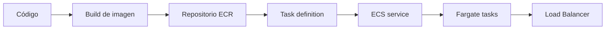
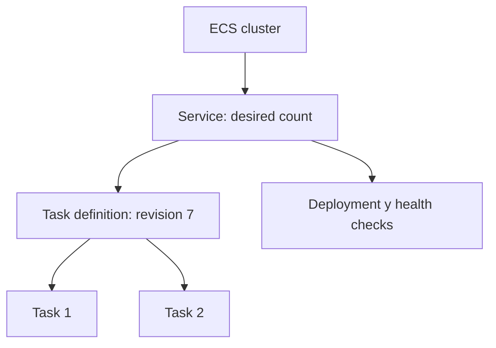
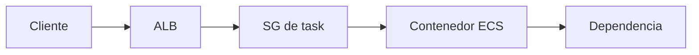

import {awsEcsBank} from './ecs-fargate-y-ecr-questions';

<ContentMeta area="AWS" level="intermedio" type="lección" topics={['ECS', 'Fargate', 'ECR', 'Contenedores']} />

<KnowledgeBlock kind="check" title="Objetivo de la lección">
Explicar cómo una imagen pasa desde un registro ECR a una tarea ECS, distinguir
task definition, task y service, y justificar decisiones de capacidad, red, roles,
health checks y despliegue con Fargate.
</KnowledgeBlock>

## 1. El problema: empaquetar y operar una aplicación

Un contenedor reúne la aplicación y sus dependencias en una imagen reproducible.
Eso simplifica el empaquetado, pero no resuelve por sí solo red, permisos,
capacidad, logs, salud ni despliegues.

| Necesidad | Pieza del modelo |
|---|---|
| Guardar una imagen | Amazon ECR |
| Describir cómo ejecutarla | ECS task definition |
| Ejecutar una instancia de esa definición | ECS task |
| Mantener tareas y desplegar versiones | ECS service |
| Ejecutar sin administrar hosts | Fargate |

<KnowledgeBlock kind="concept" title="La imagen no es el servicio">
La imagen describe un artefacto. ECS añade el contrato de ejecución y mantiene
el estado deseado del servicio. Fargate aporta capacidad gestionada, pero la
aplicación sigue necesitando red, permisos y observabilidad.
</KnowledgeBlock>

## 2. Flujo completo

El tag ayuda a identificar una imagen, pero el digest identifica su contenido de
forma inmutable. Para poder auditar y revertir, registra qué digest corresponde a
cada revisión de la task definition.
[Repositorios ECR](https://docs.aws.amazon.com/AmazonECR/latest/userguide/Repositories.html)

## 3. ECR: registro y cadena de suministro

ECR almacena imágenes privadas o públicas y se integra con permisos IAM. La imagen
debe construirse de forma repetible y revisarse antes de llegar al servicio.

| Práctica | Motivo |
|---|---|
| Tags inmutables o digest | Evitar que una etiqueta cambie silenciosamente |
| Escaneo de vulnerabilidades | Detectar problemas conocidos antes del despliegue |
| Imagen mínima | Reducir superficie y tiempo de descarga |
| Sin secretos en la imagen | Los secretos se gestionan fuera del artefacto |
| Retención de versiones | Permitir auditoría y rollback |

<KnowledgeBlock kind="caution" title="latest no es una estrategia de release">
Un servicio que solo registra `latest` puede cambiar de contenido sin cambiar el
nombre visible. Usa revisiones identificables y conserva el digest desplegado.
</KnowledgeBlock>

## 4. ECS: cluster, task definition, task y service

| Concepto | Qué representa |
|---|---|
| Cluster | Agrupación lógica donde se gestionan recursos ECS |
| Task definition | Plantilla versionada de contenedores, CPU, memoria, puertos, logs y roles |
| Task | Ejecución concreta de una task definition |
| Service | Mantiene tareas deseadas y coordina despliegues |
| Deployment | Transición entre revisiones de la definición |
| Capacity provider | Selección del modo de capacidad, como Fargate |

El service expresa estado deseado, no solo un comando de arranque. Si una task
termina, ECS puede crear otra según la estrategia y la capacidad disponible.
[Conceptos de ECS](https://docs.aws.amazon.com/AmazonECS/latest/developerguide/Welcome.html)

## 5. Fargate y capacidad

Fargate ejecuta tareas ECS sin que el equipo administre instancias EC2 del cluster.
El equipo sigue eligiendo CPU, memoria, red, almacenamiento efímero, roles y
políticas de escalado.

| Decisión | Qué comprobar |
|---|---|
| CPU y memoria | Límite del task y necesidades reales del contenedor |
| Desired count | Capacidad base y disponibilidad |
| Subnets | Distribución entre AZ y rutas |
| Security Group | Tráfico mínimo desde el balanceador o dependencias |
| Logs | Driver, grupo y retención |
| Escalado | Métrica, mínimo, máximo y estabilización |

<KnowledgeBlock kind="example" title="API detrás de un ALB">
Un service ECS mantiene dos tasks Fargate en subredes privadas. El ALB está en
subredes públicas, el SG de las tasks permite el puerto de aplicación solo desde
el SG del ALB, y el health check verifica un endpoint de readiness.
</KnowledgeBlock>

## 6. Roles: ejecución y aplicación

ECS distingue permisos que necesita la plataforma para iniciar la task de permisos
que necesita el código que corre dentro del contenedor.

| Rol | Quién lo usa | Ejemplo |
|---|---|---|
| Task execution role | ECS/Fargate durante el arranque | Descargar imagen ECR y enviar logs |
| Task role | Código del contenedor | Leer S3 o publicar eventos |

<KnowledgeBlock kind="caution" title="No mezclar roles">
Dar al task role permisos de ejecución amplios hace que la aplicación herede
capacidades que no necesita. Separa ambos roles y aplica mínimo privilegio.
</KnowledgeBlock>

## 7. Red, health checks y despliegue

Una task Fargate usa interfaces de red dentro de una VPC. El tráfico depende de
subnets, rutas, Security Groups, resolución DNS y del puerto real del contenedor.

El estado `RUNNING` solo indica que el contenedor se está ejecutando. El health
check debe demostrar que puede recibir el tráfico que el balanceador le enviará.
Durante un deployment, configura límites de tareas saludables y disponibilidad para
evitar retirar la versión anterior demasiado pronto.
[Deployments de ECS](https://docs.aws.amazon.com/AmazonECS/latest/developerguide/deployment-type-ecs.html)

## 8. Logs, escalado y operación

Un servicio operable necesita logs estructurados, métricas de tarea y servicio,
alarmas, límites y una estrategia de rollback. El escalado debe responder a demanda
o trabajo pendiente, no solo a que una task esté encendida.

| Señal | Uso |
|---|---|
| CPU y memoria | Detectar saturación del contenedor |
| Requests por target | Relacionar carga y capacidad del servicio |
| Latencia y errores | Medir resultado de usuario |
| Tasks no saludables | Detectar fallos de imagen, red o aplicación |
| Logs | Diagnosticar startup y dependencias |

## 9. ECS frente a Lambda y EKS

| Criterio | ECS/Fargate | Lambda | EKS |
|---|---|---|---|
| Unidad | Task o service | Invocación | Pod y workload Kubernetes |
| Empaquetado | Imagen de contenedor | ZIP o imagen | Imagen y manifests |
| Operación inicial | Moderada | Menor | Mayor |
| Control de plataforma | ECS y AWS | Runtime gestionado | Kubernetes y AWS |
| Ajuste habitual | APIs y workers persistentes | Eventos y tareas acotadas | Requisitos Kubernetes explícitos |

Elegir EKS solo por usar contenedores añade una plataforma completa. Primero
compara si ECS satisface el contrato operativo y de portabilidad necesario.

<KnowledgeBlock kind="check" title="Comprobación de comprensión">
Explica qué ocurre desde que se publica una nueva imagen hasta que un ECS service
la sirve detrás de un ALB. Incluye digest, task definition, roles, health check y
qué evidencia usarías para revertir.
</KnowledgeBlock>

  <QuizWorkbench bank={awsEcsBank} />

## Para continuar

Continúa con [Amazon EKS](/theory/nube/aws/06-aplicaciones/04-eks), para estudiar
Kubernetes administrado después de comprender el modelo de tareas y servicios.
