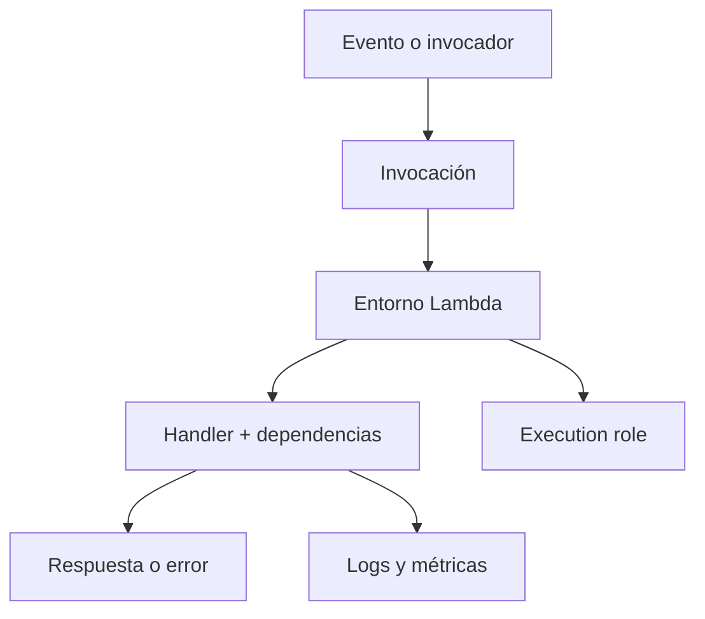
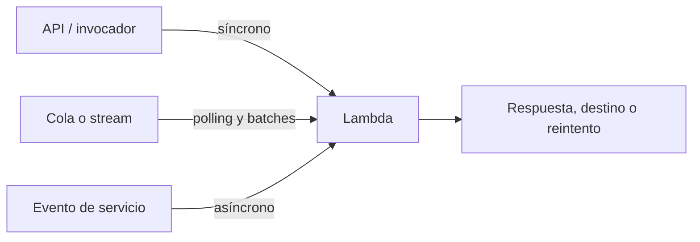
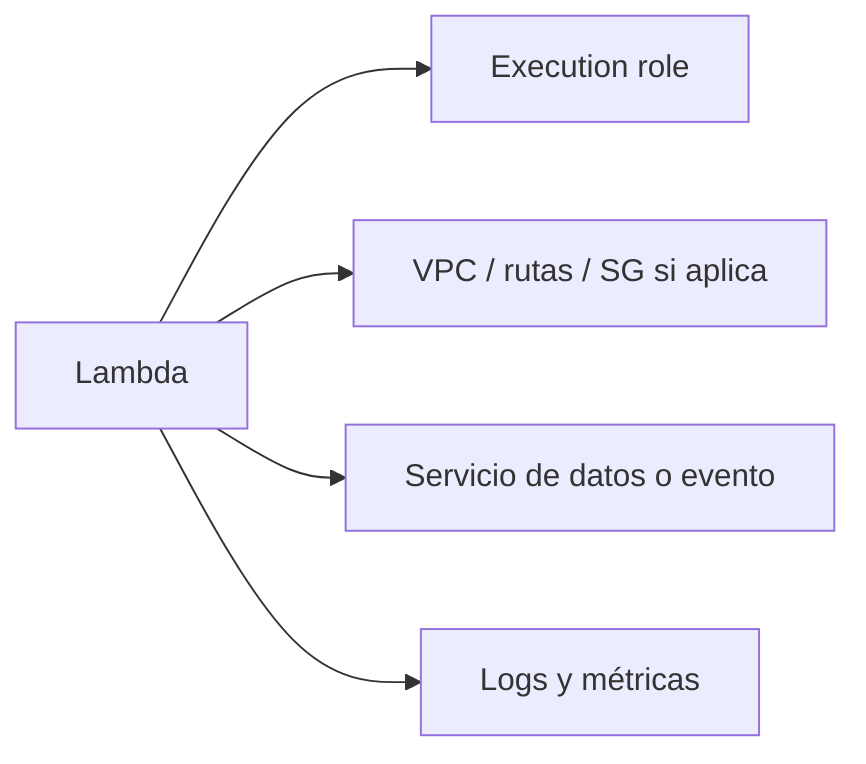

import {awsLambdaBank} from './lambda-questions';

<ContentMeta area="AWS" level="intermedio" type="lección" topics={['Lambda', 'Eventos', 'Cómputo']} />

<KnowledgeBlock kind="check" title="Objetivo de la lección">
Explicar cómo Lambda ejecuta funciones ante invocaciones, y justificar decisiones
de eventos, permisos, concurrencia, reintentos, estado y observabilidad para una
carga concreta.
</KnowledgeBlock>

## 1. El problema: ejecutar sin administrar un servidor

Muchas tareas necesitan ejecutar código solo cuando ocurre algo: llega una solicitud,
se crea un objeto, aparece un mensaje o se programa una acción. Administrar una
instancia permanente para cada tarea puede trasladar trabajo operativo que no aporta
valor al resultado.

| Pregunta | Decisión en Lambda |
|---|---|
| ¿Qué inicia el trabajo? | Invocación directa, servicio AWS o endpoint |
| ¿Cuánto puede durar? | Timeout y modelo de ejecución |
| ¿Qué pasa si falla? | Reintento, DLQ, destino o error al invocador |
| ¿Dónde vive el estado? | Servicio externo, no memoria local como contrato |

<KnowledgeBlock kind="concept" title="Lambda administra la infraestructura, no la lógica">
AWS administra servidores y capacidad de la plataforma. El equipo sigue siendo
responsable del código, dependencias, configuración, permisos, datos y diseño de
errores.
</KnowledgeBlock>

## 2. Modelo de ejecución

Una función tiene código, runtime, memoria, timeout, variables de entorno, capas o
imagen y una **execution role**. Lambda crea un entorno de ejecución para procesar
la invocación; ese entorno puede reutilizarse, pero no debe tratarse como estado
persistente garantizado.

| Elemento | Decisión |
|---|---|
| Handler | Punto de entrada y contrato del evento |
| Runtime | Lenguaje y versión soportada |
| Memoria | Capacidad y efecto sobre CPU según la configuración |
| Timeout | Límite máximo de una invocación |
| Execution role | Permisos que usa el código contra otros servicios |
| Variables de entorno | Configuración no sensible o referencias a configuración segura |

El entorno puede experimentar un **cold start** al inicializar runtime y dependencias.
Una invocación posterior puede reutilizarlo, pero el código debe funcionar también
cuando se crea uno nuevo.
[Modelo de programación de Lambda](https://docs.aws.amazon.com/lambda/latest/dg/lambda-runtime-environment.html)

## 3. Invocación y eventos

El tipo de invocación cambia quién espera el resultado y cómo se gestionan los fallos.

| Modelo | Quién recibe el resultado | Consideración |
|---|---|---|
| Síncrono | El invocador espera la respuesta | El error vuelve directamente al cliente o servicio |
| Asíncrono | Lambda acepta el evento y procesa después | Puede haber reintentos y destinos configurados |
| Basado en polling | Lambda consume una fuente mediante un event source mapping | Hay lotes, offsets, visibilidad y errores parciales |

El contrato del evento debe versionarse y validarse. No supongas que todos los
invocadores entregan el mismo formato ni que un evento se procesa una sola vez.
[Invocación de Lambda](https://docs.aws.amazon.com/lambda/latest/dg/lambda-invocation.html)

## 4. Reintentos e idempotencia

Un fallo de red, timeout o error del destino puede provocar que el mismo evento se
procese de nuevo. Una función **idempotente** produce el mismo efecto válido aunque
reciba repetidamente el mismo evento.

| Técnica | Para qué sirve |
|---|---|
| Idempotency key | Reconocer una operación ya aplicada |
| Estado de procesamiento | Registrar éxito antes de aceptar duplicados |
| Condición atómica | Evitar dos escrituras concurrentes incompatibles |
| DLQ o destino de fallo | Conservar eventos que no pudieron procesarse |
| Backoff | Evitar sobrecargar una dependencia durante reintentos |

<KnowledgeBlock kind="example" title="Evento de pago repetido">
Un evento `PaymentCaptured` puede llegar dos veces. Antes de crear un recibo,
la función consulta una clave de operación única y registra el resultado de forma
atómica. El segundo intento devuelve el resultado existente en lugar de duplicar
el efecto.
</KnowledgeBlock>

<KnowledgeBlock kind="caution" title="Reintentar no corrige una operación no segura">
Si la función envía un correo, cobra o publica un mensaje antes de registrar su
resultado, un reintento puede repetir el efecto. Diseña idempotencia y límites de
reintento antes de activar procesamiento automático.
</KnowledgeBlock>

## 5. Concurrencia, límites y rendimiento

Lambda crea ejecuciones concurrentes según las invocaciones y los límites de la
cuenta o función. La concurrencia puede agotarse; además, la dependencia downstream
puede no soportar que Lambda aumente llamadas rápidamente.

| Control | Propósito |
|---|---|
| Reserved concurrency | Reservar y limitar concurrencia de una función |
| Provisioned concurrency | Mantener entornos inicializados para reducir cold starts |
| Timeout | Impedir ejecuciones que consumen recursos indefinidamente |
| Memory | Ajustar recursos y, según el runtime, CPU disponible |
| Batch size | Controlar cantidad de registros por invocación de polling |

La latencia total incluye inicialización, código y dependencias. No aumentes
concurrencia sin revisar cuotas, conexiones a bases de datos, límites de APIs y
capacidad de colas.
[Concurrencia de Lambda](https://docs.aws.amazon.com/lambda/latest/dg/lambda-concurrency.html)

## 6. Red, permisos y estado

Una función recibe permisos mediante su execution role. El rol debe permitir solo
las acciones y recursos que la función necesita. Si Lambda se conecta a recursos
privados, la configuración de VPC, subredes, rutas y Security Groups forma parte
del camino; añadir una función a una VPC no es automáticamente una solución de
conectividad a Internet.

| Necesidad | Diseño |
|---|---|
| Leer un objeto | Acción S3 sobre el bucket y prefijo necesarios |
| Publicar evento | Permiso de `PutEvents`, `Publish` o envío correspondiente |
| Acceder a datos privados | VPC, rutas, SG y credenciales compatibles |
| Guardar secreto | Secrets Manager o Parameter Store, no código fuente |
| Mantener estado | DynamoDB, S3, RDS u otro servicio elegido explícitamente |

## 7. Observabilidad y errores

CloudWatch Logs registra la salida de la función y CloudWatch Metrics permite
observar invocaciones, errores, duración, throttles y concurrencia. Las métricas
deben relacionarse con el resultado de negocio y las dependencias.

| Señal | Pregunta |
|---|---|
| Errors | ¿Qué invocaciones fallaron y con qué causa? |
| Duration | ¿Se acerca el tiempo al timeout? |
| Throttles | ¿Se alcanzó un límite de concurrencia? |
| IteratorAge | ¿Existe retraso en una fuente de stream compatible, como Kinesis o DynamoDB Streams? |
| ApproximateAgeOfOldestMessage (SQS) | ¿Se acumula trabajo antiguo en una cola SQS? |
| Logs correlacionados | ¿Qué evento y dependencia produjo el fallo? |

<KnowledgeBlock kind="check" title="Comprobación de diagnóstico">
Si una función procesa una cola lentamente, distingue entre duración por mensaje,
tamaño de lote, concurrencia disponible, errores que provocan reintentos y capacidad
de la dependencia. No atribuyas el retraso solo a la CPU de Lambda.
</KnowledgeBlock>

Para SQS, usa métricas de cola junto a duración, errores y throttles de la
función. IteratorAge no es la métrica de antigüedad de SQS.
[Métricas de SQS](https://docs.aws.amazon.com/AWSSimpleQueueService/latest/SQSDeveloperGuide/sqs-available-cloudwatch-metrics.html).

## 8. Lambda frente a EC2 y ECS/Fargate

| Criterio | Lambda | EC2 | ECS/Fargate |
|---|---|---|---|
| Infraestructura | Muy gestionada | Control del host | Contenedores gestionados |
| Activación | Invocaciones y eventos | Proceso persistente | Servicio o tarea |
| Duración | Limitada por invocación | Adecuada para procesos largos | Adecuada para procesos largos |
| Empaquetado | ZIP o imagen | AMI y software | Imagen de contenedor |
| Estado | Externo a la función | Puede existir localmente, con límites | Debe diseñarse según tareas |
| Ajuste habitual | Eventos y cargas variables | Control del sistema operativo | APIs o workers empaquetados |

<KnowledgeBlock kind="check" title="Criterio para continuar">
Justifica si una tarea que tarda minutos, recibe eventos irregulares y escribe en
una base de datos debería usar Lambda. Incluye timeout, reintentos, idempotencia,
concurrencia y permisos.
</KnowledgeBlock>

  <QuizWorkbench bank={awsLambdaBank} />

## Para continuar

Continúa con [ECS, Fargate y ECR](/theory/nube/aws/06-aplicaciones/03-contenedores),
para comparar funciones con tareas y servicios basados en contenedores.
