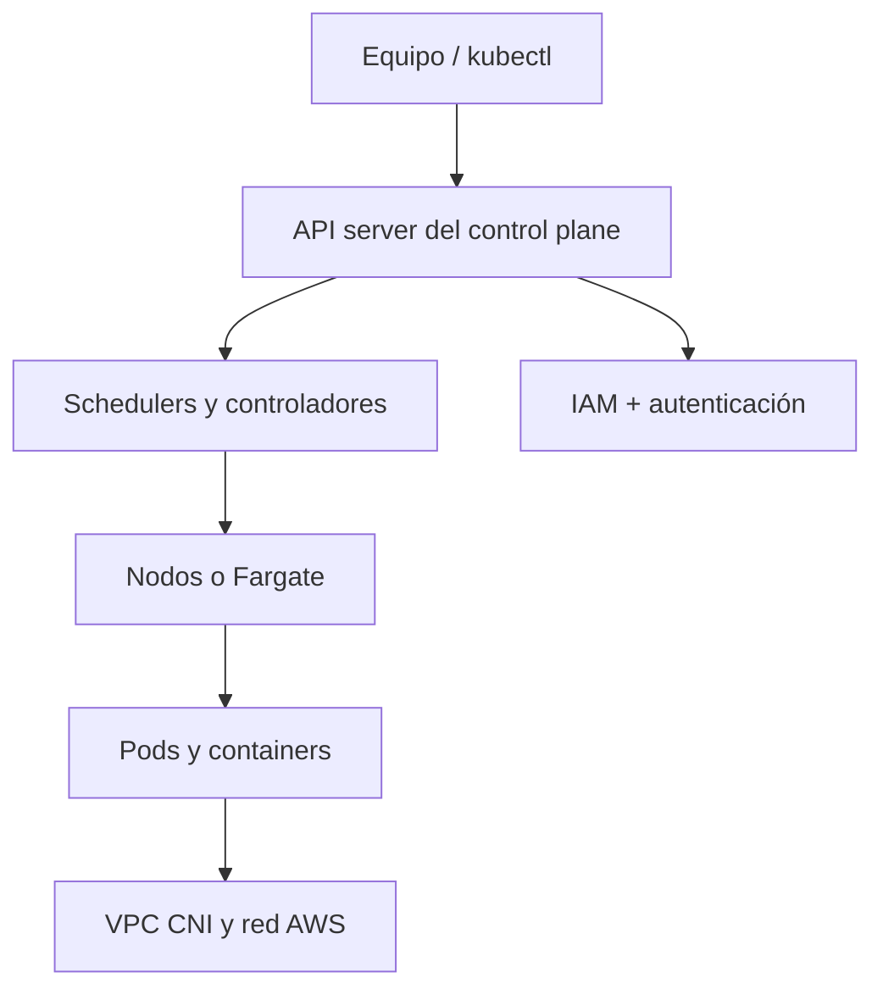
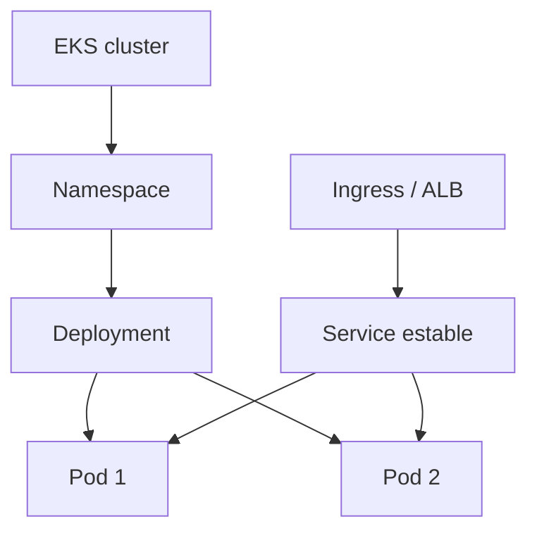
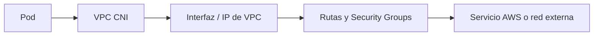
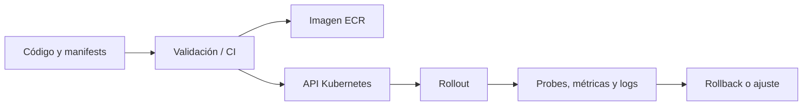

import {awsEksBank} from './eks-questions';

<ContentMeta area="AWS" level="avanzado" type="lección" topics={['EKS', 'Kubernetes', 'Contenedores']} />

<KnowledgeBlock kind="check" title="Objetivo de la lección">
Explicar qué administra EKS y qué sigue administrando el equipo, relacionar
cluster, control plane, nodos y workloads, y evaluar cuándo Kubernetes justifica
su complejidad frente a ECS/Fargate.
</KnowledgeBlock>

## 1. El problema: Kubernetes sin administrar todo el control plane

Kubernetes ofrece una API y un modelo declarativo para coordinar workloads, pero
operar sus componentes requiere conocimientos de control plane, nodos, red,
identidad, almacenamiento y observabilidad. EKS reduce una parte de esa carga,
no la elimina.

| Necesidad | Decisión en EKS |
|---|---|
| Ejecutar workloads Kubernetes | Cluster y recursos Kubernetes |
| Proveer capacidad | Managed node groups, Karpenter o Fargate según el caso |
| Conectar pods y servicios | VPC CNI, subnets, Security Groups y balanceadores |
| Autorizar workloads | IAM, RBAC e IRSA / EKS Pod Identity según el diseño |
| Observar y actualizar | Logs, métricas, versiones y procedimientos de upgrade |

<KnowledgeBlock kind="concept" title="EKS no es solo un cluster creado">
Crear el cluster es el inicio. La operación real incluye workloads, manifests,
políticas, capacidad, actualizaciones, red, almacenamiento, costes y diagnóstico.
</KnowledgeBlock>

## 2. Arquitectura y responsabilidades

AWS gestiona la disponibilidad de componentes del control plane administrado. El
equipo debe definir y operar los objetos Kubernetes, sus imágenes, permisos,
recursos, actualizaciones y dependencias.

| AWS gestiona | El equipo gestiona |
|---|---|
| Control plane administrado | Manifests, namespaces y workloads |
| Componentes del servicio EKS | Imágenes, versiones y configuración |
| Integración de la API del servicio | RBAC, IAM y acceso de operadores |
| Opciones de capacidad administrada | Nodos, pods, requests y límites |
| Parte de la infraestructura subyacente | Red, observabilidad, almacenamiento y costes |

[Modelo de responsabilidad de EKS](https://docs.aws.amazon.com/eks/latest/userguide/shared-responsibility.html)

## 3. Cluster, nodos, pods y servicios

| Concepto | Función |
|---|---|
| Cluster | Límite lógico de recursos Kubernetes y control plane |
| Node | Capacidad donde se ejecutan pods |
| Pod | Unidad mínima de scheduling, con uno o más containers |
| Deployment | Mantiene réplicas y revisiones de un workload |
| Service | Descubrimiento y exposición estable de pods |
| Ingress / Gateway | Entrada HTTP según el controlador instalado |
| Namespace | Agrupación lógica y límite de organización o políticas |

Un pod que está `Running` no necesariamente está listo para recibir tráfico.
Un Service selecciona pods mediante labels y selectors y utiliza puertos de
servicio y destino. Un selector equivocado puede dejarlo sin endpoints aunque
los pods estén ejecutándose. ClusterIP ofrece un punto interno; exponerlo hacia
fuera requiere elegir el tipo y controlador adecuados.

`readinessProbe` y `livenessProbe` expresan condiciones distintas: la primera
decide si puede recibir tráfico; la segunda ayuda a detectar un proceso que no
se recupera correctamente.

## 4. Capacidad: nodos administrados y Fargate

EKS puede ejecutar pods sobre managed node groups, otros mecanismos de nodos o
perfiles Fargate. La elección afecta control, coste, compatibilidad y operación.

| Opción | Ventaja | Límite o trabajo |
|---|---|---|
| Managed node group | Control de familias, daemonsets y capacidad | Parches, AMI, escalado y nodos |
| Fargate profile | Sin administrar nodos para pods compatibles | Restricciones de scheduling y capacidades |
| Capacidad dinámica | Ajuste automatizado según pods | Requiere diseño y observabilidad adicionales |

Los `requests` y `limits` de CPU y memoria influyen en scheduling y protección del
nodo. Un request ausente o incorrecto puede provocar colocación deficiente; un
limit demasiado bajo puede terminar el contenedor por falta de memoria.

[Compute options de EKS](https://docs.aws.amazon.com/eks/latest/userguide/eks-compute.html)

## 5. Red e integración con AWS

El VPC CNI asigna direcciones de la VPC a interfaces de red de pods según la
configuración. Eso conecta Kubernetes con la red AWS, pero también consume capacidad
de IP y obliga a considerar subnets, rutas, Security Groups y límites.

AWS Load Balancer Controller puede traducir recursos Kubernetes a balanceadores
AWS. El controlador, sus permisos y los manifests deben versionarse y observarse;
crear un `Service` no explica por sí solo qué balanceador se desplegará.

[Networking de EKS](https://docs.aws.amazon.com/eks/latest/userguide/eks-networking.html),
[AWS Load Balancer Controller](https://docs.aws.amazon.com/eks/latest/userguide/aws-load-balancer-controller.html)

## 6. Identidad: IAM y RBAC

Kubernetes y AWS tienen sistemas de autorización distintos. IAM controla acceso a
la API de AWS; RBAC controla acciones sobre recursos Kubernetes. Un pod que necesita
leer S3 requiere una relación explícita entre su identidad de workload y permisos IAM.

| Capa | Controla |
|---|---|
| IAM del operador | Qué puede hacer una persona o rol en AWS y EKS |
| Autenticación al cluster | Quién puede entrar a la API Kubernetes |
| RBAC | Qué puede hacer esa identidad dentro de Kubernetes |
| Identidad del pod | Qué permisos AWS recibe el workload |

<KnowledgeBlock kind="caution" title="No dar permisos AWS al nodo por comodidad">
Si todos los pods heredan un rol amplio del nodo, una vulnerabilidad en un workload
puede acceder a recursos no relacionados. Prefiere una identidad específica del pod
y mínimo privilegio.
</KnowledgeBlock>

[IAM roles for service accounts](https://docs.aws.amazon.com/eks/latest/userguide/iam-roles-for-service-accounts.html)

Configura también el acceso de operadores al cluster mediante los mecanismos
admitidos, como access entries, y asigna autorización Kubernetes apropiada. Poder
describir el cluster en AWS no implica poder listar o modificar sus pods.

IRSA o EKS Pod Identity acotan permisos del workload, pero hay que revisar el
acceso a IMDS: si un pod puede obtener credenciales del nodo, la separación puede
ser insuficiente. Restringe ese camino según las necesidades y comprueba qué rol
utiliza realmente el código.
[Identidad y acceso en EKS](https://docs.aws.amazon.com/eks/latest/best-practices/identity-and-access-management.html).

## 7. Despliegue y operación

El flujo declarativo permite revisar cambios antes de aplicarlos.

| Evidencia | Qué permite comprobar |
|---|---|
| Imagen por digest | Qué artefacto se ejecuta |
| Manifest versionado | Qué configuración se pretendía aplicar |
| Estado del rollout | Si las réplicas están disponibles |
| Probes | Si el pod está listo o necesita reinicio |
| Logs y eventos | Por qué el scheduler o contenedor falló |
| Métricas de nodo y pod | Si falta capacidad o existe saturación |

## 8. Actualizaciones, almacenamiento y observabilidad

La versión del cluster, add-ons, nodos y workloads debe formar parte de un ciclo
de mantenimiento. Antes de actualizar, revisa compatibilidad, backups y rollback.

El almacenamiento persistente requiere elegir una clase y un mecanismo compatible
con el workload. Un volumen efímero del pod no sustituye un PersistentVolume cuando
los datos deben sobrevivir a su reemplazo.

CloudWatch y Container Insights pueden aportar métricas y logs, pero deben
configurarse con retención, coste y correlación adecuados.

## 9. EKS frente a ECS/Fargate

| Criterio | EKS | ECS/Fargate |
|---|---|---|
| Plataforma | Kubernetes | Orquestación AWS |
| Portabilidad | Alta dentro del ecosistema Kubernetes | Menor, con integración AWS directa |
| Complejidad inicial | Mayor | Menor |
| Control | Ecosistema y extensiones Kubernetes | Modelo ECS y capacidad AWS |
| Primer criterio | Requisito real de Kubernetes o plataforma | Servicio contenedorizado sin necesidad de Kubernetes |

La portabilidad no es gratis: hay que operar manifests, extensiones, versiones,
red, identidad y observabilidad. Si ECS resuelve el problema con menor carga,
EKS no aporta valor solo por usar contenedores.

<KnowledgeBlock kind="check" title="Comprobación de comprensión">
Justifica si una API nueva debería desplegarse en EKS o ECS/Fargate. Explica qué
requisito concreto de Kubernetes, portabilidad o plataforma inclina la decisión y
qué responsabilidades operativas adicionales asumirías.
</KnowledgeBlock>

  <QuizWorkbench bank={awsEksBank} />

## Para continuar

Continúa con [API Gateway](/theory/nube/aws/06-aplicaciones/01-lambda-y-api-gateway),
para estudiar la exposición administrada de APIs frente a la entrada mediante
balanceadores y controladores Kubernetes.
