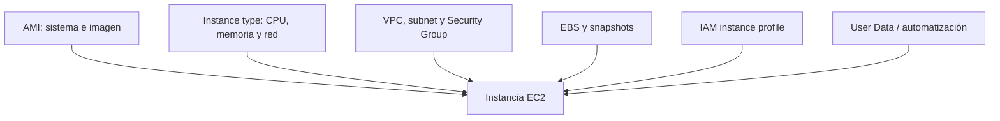
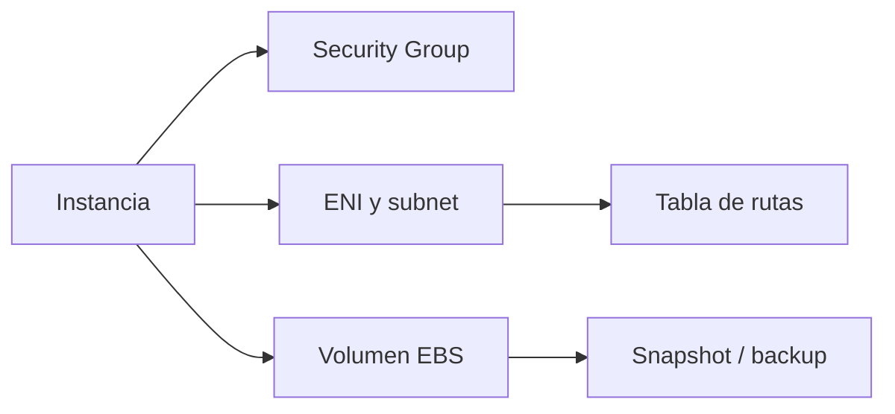
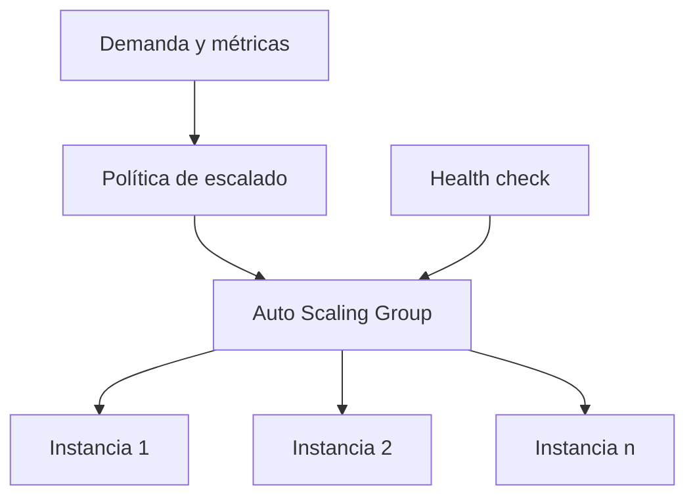

import {awsEc2Bank} from './ec2-questions';

<ContentMeta area="AWS" level="intermedio" type="lección" topics={['EC2', 'Cómputo', 'Operación']} />

<KnowledgeBlock kind="check" title="Objetivo de la lección">
Explicar qué decisiones componen una instancia EC2, distinguir el control que
conserva el equipo del que ofrece AWS y justificar una configuración básica de
red, almacenamiento, acceso y escalado.
</KnowledgeBlock>

## 1. El problema: flexibilidad a cambio de operación

Una máquina virtual permite ejecutar software con control del sistema operativo,
pero ese control trae trabajo: parches, capacidad, agentes, discos, acceso y
recuperación. EC2 no es “un servidor listo”; es una capacidad configurable que
debe operar correctamente.

| Necesidad | Decisión en EC2 |
|---|---|
| Ejecutar el sistema y el runtime | AMI, tipo de instancia y configuración |
| Alcanzar dependencias | VPC, subred, rutas y Security Group |
| Conservar datos | Volúmenes EBS, snapshots y backups |
| Mantener capacidad | Auto Scaling, health checks y límites |

<KnowledgeBlock kind="concept" title="La instancia es una composición">
Una instancia no se define solo por CPU. Su comportamiento depende de imagen,
tipo, red, almacenamiento, identidad, inicialización y ciclo de vida.
</KnowledgeBlock>

## 2. Modelo mental de una instancia

| Componente | Qué define | Pregunta de operación |
|---|---|---|
| AMI | Sistema y software inicial | ¿Es reproducible y está actualizada? |
| Instance type | CPU, memoria, red y posibles aceleradores | ¿Coincide con el perfil de carga? |
| Subnet | Ubicación y caminos de red | ¿Debe ser pública o privada? |
| Security Group | Flujos permitidos | ¿Qué origen necesita cada puerto? |
| EBS | Estado persistente asociado | ¿Qué datos deben sobrevivir? |
| Instance profile | Credenciales temporales para la instancia | ¿Qué permisos necesita el software? |

## 3. Imagen y tipo de instancia

Una **AMI** sirve como plantilla para lanzar instancias. Puede ser proporcionada
por AWS, publicada por un tercero o creada por el equipo. El origen, el ciclo de
parches y el software incluido deben ser conocidos.

El **instance type** combina recursos y límites. Elegirlo requiere observar la
carga, no solo buscar el número mayor de vCPU.

| Señal | Posible decisión |
|---|---|
| CPU sostenida | Tipo con más capacidad de cómputo o más réplicas |
| Memoria insuficiente | Familia con más memoria |
| I/O de disco | Revisar volumen, IOPS, throughput y patrón de acceso |
| Red saturada | Revisar tipo, tráfico y arquitectura |
| Carga variable | Auto Scaling y una línea base adecuada |

<KnowledgeBlock kind="caution" title="Más tamaño no corrige cualquier cuello de botella">
Si la dependencia lenta es una base de datos, una red o el disco, aumentar la CPU
de la instancia puede elevar el coste sin mejorar la operación. Mide el recurso y
el resultado de usuario antes de cambiar el tipo.
</KnowledgeBlock>

[Tipos de instancia](https://docs.aws.amazon.com/ec2/latest/instancetypes/instance-types.html)

## 4. Ciclo de vida y acceso

Una instancia puede estar pendiente, ejecutándose, detenida, reiniciándose o
terminada. Detenerla y terminarla no tienen el mismo efecto sobre los recursos y
datos asociados.

| Acción | Idea principal |
|---|---|
| Stop | Detiene la ejecución; algunos recursos asociados permanecen |
| Reboot | Reinicia el sistema operativo dentro del ciclo de la instancia |
| Terminate | Elimina la instancia; algunos volúmenes pueden eliminarse según configuración |
| Recover / reemplazar | Restablece capacidad según el mecanismo y el tipo de fallo |

Para administración, un rol asociado mediante **instance profile** permite obtener
credenciales temporales. No guardes claves de larga duración en el código o en el
disco de la instancia. Session Manager puede evitar exponer SSH públicamente cuando
el entorno y los permisos están preparados.

[Instance profiles](https://docs.aws.amazon.com/IAM/latest/UserGuide/id_roles_use_switch-role-ec2_instance-profiles.html),
[Systems Manager Session Manager](https://docs.aws.amazon.com/systems-manager/latest/userguide/session-manager.html)

## 5. Red y almacenamiento

La instancia hereda el diseño de la VPC: subnet, tabla de rutas, interfaz de red
y Security Group. La ruta al destino y la regla de tráfico deben existir en conjunto.

EBS proporciona volúmenes de bloques para la instancia. Un volumen puede contener
el sistema operativo o datos que deben conservarse; los snapshots son copias
puntuales que deben restaurarse y comprobarse, no una garantía automática de
recuperación.

<KnowledgeBlock kind="example" title="API privada en EC2">
Una API puede vivir en una subnet privada, aceptar tráfico solo desde el SG del
balanceador y usar un rol de instancia para leer un servicio AWS. Sus datos pueden
estar en EBS o en una base gestionada según las necesidades de persistencia y operación.
</KnowledgeBlock>

[Amazon EBS](https://docs.aws.amazon.com/ebs/latest/userguide/what-is-ebs.html)

Algunos tipos ofrecen instance store, almacenamiento local efímero con un ciclo
de vida diferente a EBS. Los datos que deban sobrevivir a pérdida o reemplazo del
host necesitan persistencia y recuperación externas. No extrapoles las reglas
de EBS al disco local.
[Instance store](https://docs.aws.amazon.com/AWSEC2/latest/UserGuide/InstanceStorage.html).

Detener cómputo tampoco elimina todos los cargos: volúmenes, snapshots y otros
recursos pueden permanecer. Antes de terminar una instancia, revisa conservación
de datos, DeleteOnTermination y recursos asociados.

## 6. Inicialización y despliegue

**User Data** permite ejecutar acciones durante el primer arranque, pero no debería
convertirse en un script opaco que contenga secretos o que tarde indefinidamente.
Para entornos repetibles conviene producir AMIs o automatizar la configuración con
herramientas de gestión e infraestructura como código.

| Enfoque | Ventaja | Riesgo |
|---|---|---|
| User Data | Simple para una inicialización breve | Difícil de probar si crece demasiado |
| AMI preparada | Arranque más predecible | Hay que actualizar y versionar la imagen |
| Configuración gestionada | Separación de código y operación | Requiere agentes, permisos y diseño |
| Imagen + IaC | Reproducibilidad y revisión | Mayor inversión inicial |

## 7. Capacidad y Auto Scaling

Un **Auto Scaling Group (ASG)** mantiene una capacidad deseada dentro de mínimos y
máximos, y puede reemplazar instancias no saludables. No convierte automáticamente
una aplicación con estado local en una aplicación distribuida.

| Decisión | Qué comprobar |
|---|---|
| Mínimo | Capacidad base y coste continuo |
| Deseado | Capacidad inicial o habitual |
| Máximo | Límite de coste y dependencias |
| Señal | Relación con demanda, latencia o trabajo pendiente |
| Health check | Que retire destinos realmente no utilizables |

<KnowledgeBlock kind="caution" title="Escalar instancias no replica automáticamente el estado">
Sesiones, archivos locales y trabajos en memoria pueden perderse o divergir al
añadir o reemplazar instancias. Usa almacenamiento o servicios compartidos cuando
la operación necesite sobrevivir al ciclo de una instancia.
</KnowledgeBlock>

[Auto Scaling Groups](https://docs.aws.amazon.com/autoscaling/ec2/userguide/auto-scaling-groups.html)

## 8. Responsabilidades y decisiones

AWS administra la infraestructura física y el servicio EC2; el equipo sigue siendo
responsable del sistema operativo invitado, configuración, software, datos, acceso
y controles que despliegue.

| AWS proporciona | El equipo debe operar |
|---|---|
| Infraestructura física y capacidad del servicio | Sistema operativo y parches |
| Integración con red y almacenamiento definidos | Aplicación, runtime y agentes |
| APIs para ciclo de vida | IAM, Security Groups y exposición |
| Opciones de monitorización | Métricas, alarmas, backups y recuperación |

<KnowledgeBlock kind="check" title="Comprobación de comprensión">
Justifica cuándo usarías EC2 en lugar de Lambda o ECS Fargate. Incluye el control
del sistema operativo, el patrón de carga, el almacenamiento, el acceso y el trabajo
operativo que asumiría el equipo.
</KnowledgeBlock>

  <QuizWorkbench bank={awsEc2Bank} />

## Para continuar

Continúa con [AWS Lambda](/theory/nube/aws/06-aplicaciones/01-lambda), para comparar
cómputo basado en funciones con máquinas virtuales persistentes.
