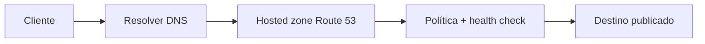
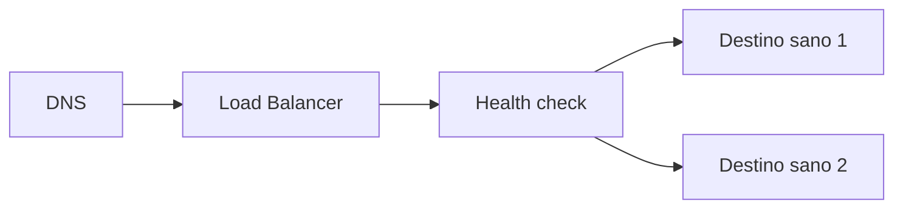
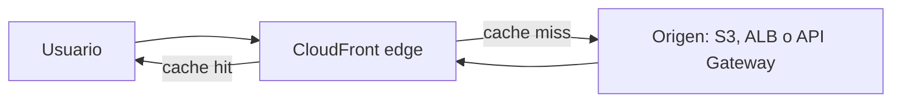
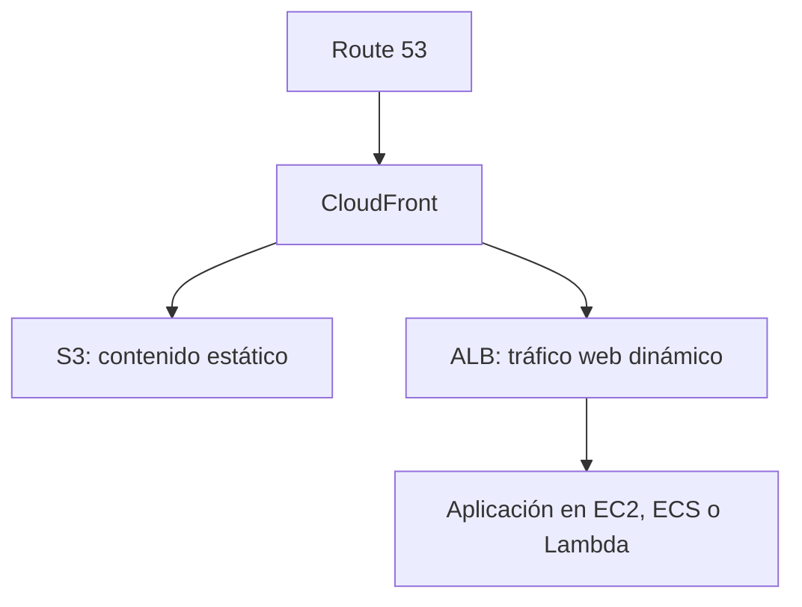

import {awsDnsBank} from './dns-balanceo-y-cdn-questions';

<ContentMeta area="AWS" level="intermedio" type="lección" topics={['DNS', 'Balanceo', 'CDN']} />

<KnowledgeBlock kind="check" title="Objetivo de la lección">
Distinguir resolución de nombres, distribución de tráfico y entrega en edge, y
componer Route 53, Elastic Load Balancing y CloudFront según el origen y el
comportamiento que debe conseguirse.
</KnowledgeBlock>

## 1. Tres problemas distintos

Un nombre estable, un grupo de destinos y una caché cercana al usuario resuelven
problemas relacionados, pero no equivalentes.

| Necesidad | Componente conceptual | Pregunta |
|---|---|---|
| Resolver un nombre | DNS / Route 53 | ¿Qué destino debe recibir este nombre? |
| Repartir conexiones | Load Balancer | ¿Qué destino saludable atiende esta solicitud? |
| Acercar contenido | CDN / CloudFront | ¿Puede responderse desde una ubicación edge? |

<KnowledgeBlock kind="concept" title="DNS no es balanceo de aplicaciones">
DNS entrega una respuesta de resolución según una política y un TTL. Un balanceador
recibe tráfico y lo distribuye entre destinos; una CDN puede responder desde caché
sin llegar al origen. Confundir estas capas produce diagnósticos incompletos.
</KnowledgeBlock>

## 2. Route 53 y resolución

Route 53 puede alojar zonas DNS, responder consultas y aplicar políticas como
simple, weighted, latency-based, geolocation y failover. La política decide qué
respuesta entregar; el TTL influye en cuánto tiempo los resolvers pueden conservarla.

| Política | Idea principal | Uso posible |
|---|---|---|
| Simple | Una respuesta o conjunto fijo | Un destino estable |
| Weighted | Distribuir por pesos | Migración gradual o experimento |
| Latency-based | Elegir la menor latencia entre regiones | Usuarios geográficamente distribuidos |
| Failover | Primario y secundario según salud | Conmutación controlada |

Un health check ayuda a decidir si un destino responde según la comprobación
definida; no prueba toda la operación de negocio. Revisa el endpoint, el origen de
la comprobación y el comportamiento ante estados desconocidos.
[Routing policies de Route 53](https://docs.aws.amazon.com/Route53/latest/DeveloperGuide/routing-policy.html)

## 3. Elastic Load Balancing

Elastic Load Balancing recibe conexiones y las dirige a destinos registrados,
usando listeners, reglas y health checks. El tipo de balanceador debe corresponder
al protocolo y a la forma de enrutamiento.

| Balanceador | Tráfico y decisión | Ejemplo |
|---|---|---|
| Application Load Balancer | HTTP/HTTPS, host, path y headers | API o microservicios web |
| Network Load Balancer | TCP/UDP/TLS y conexiones de alto rendimiento | Protocolos no HTTP |
| Gateway Load Balancer | Appliances virtuales de red | Inspección especializada |

<KnowledgeBlock kind="caution" title="Un health check no es una prueba completa">
Un destino puede responder al endpoint de salud y fallar al acceder a una
dependencia crítica. El endpoint debe representar la disponibilidad que realmente
necesita el balanceador, sin convertir una dependencia lenta en una cascada de fallos.
</KnowledgeBlock>

[Elastic Load Balancing](https://docs.aws.amazon.com/elasticloadbalancing/latest/userguide/what-is-load-balancing.html)

## 4. CloudFront y el origen

CloudFront es una CDN que distribuye contenido desde ubicaciones edge. Una
distribución define orígenes, comportamientos de caché, métodos permitidos,
certificado TLS y cómo se reenvían headers, cookies y query strings.

| Decisión | Impacto |
|---|---|
| TTL | Cuánto puede servirse una respuesta sin consultar el origen |
| Cache key | Qué variantes se consideran objetos diferentes |
| Métodos permitidos | Si se atienden solo lecturas o también escrituras |
| Headers y cookies reenviados | Información disponible para el origen y fragmentación de caché |
| Invalidación | Cómo retirar objetos antes de que expire su TTL |

<KnowledgeBlock kind="example" title="Sitio estático y API">
Route 53 resuelve el dominio hacia CloudFront. La distribución entrega archivos
estáticos desde S3 y dirige las rutas de API a un origen de aplicación. El contenido
cacheable y las solicitudes dinámicas no deben compartir automáticamente la misma
política de caché.
</KnowledgeBlock>

[Cómo funciona CloudFront](https://docs.aws.amazon.com/AmazonCloudFront/latest/DeveloperGuide/Introduction.html)

## 5. TLS, acceso al origen y caché

Publicar un origen detrás de CloudFront o un balanceador no elimina las decisiones
de seguridad. Hay que decidir dónde termina TLS, quién puede llegar al origen y qué
respuestas pueden cachearse.

| Pregunta | Comprobación |
|---|---|
| ¿Dónde termina HTTPS? | Certificado, listener y protocolo hacia el siguiente salto |
| ¿Puede accederse al origen directamente? | SG, bucket policy, origin access control o restricciones equivalentes |
| ¿Se puede cachear la respuesta? | Método, autenticación, cookies, headers y datos personales |
| ¿Cómo se retira una versión? | Invalidación, nombres versionados o expiración |

Una respuesta personalizada por usuario no debe cachearse con una clave que ignore
la identidad. Cachear más no siempre mejora el sistema: puede servir datos obsoletos
o aumentar el riesgo de exposición.

## 6. Componer el recorrido

Un patrón de publicación puede combinar las tres capas:

| Flujo | Decisión principal |
|---|---|
| Nombre → CloudFront | Dominio, certificado y política DNS |
| CloudFront → S3 | Acceso privado al origen y caché de objetos |
| CloudFront → ALB | Reglas de comportamiento y caché dinámica |
| ALB → aplicación | Health checks, listeners y destinos sanos |

## 7. Fallos y diagnóstico

| Síntoma | Capas que revisar |
|---|---|
| El dominio no resuelve | Zona, registro, delegación, TTL y health check |
| Responde un destino incorrecto | Política DNS, caché del resolver y pesos |
| El balanceador devuelve error | Listener, regla, SG, health check y destino |
| CDN entrega contenido antiguo | TTL, cache key, invalidación y versión del objeto |
| CDN no llega al origen | Ruta, SG, política del origen y certificado |

<KnowledgeBlock kind="check" title="Diagnóstico por capas">
Ante un error, separa resolución DNS, conexión al punto de entrada, selección del
destino y respuesta del origen. No concluyas que el balanceador está fallando solo
porque el navegador muestra un error de la aplicación.
</KnowledgeBlock>

## 8. Errores frecuentes

<KnowledgeBlock kind="caution" title="Decisiones que suelen confundirse">
- Usar DNS weighted como si fuera un health check de la aplicación completa.
- Configurar un health check que siempre responde 200 aunque la dependencia crítica falle.
- Cachear respuestas autenticadas sin incluir la identidad en la política adecuada.
- Dejar el origen público cuando el objetivo era que solo CloudFront lo alcanzara.
- Cambiar pesos o TTL durante una incidencia sin registrar el estado previo.
</KnowledgeBlock>

<KnowledgeBlock kind="check" title="Comprobación de comprensión">
Explica qué ocurre cuando un usuario solicita `app.example.com/api/courses`: qué
resuelve Route 53, qué decide CloudFront, cuándo interviene el balanceador y qué
evidencia revisarías si aparece una respuesta antigua.
</KnowledgeBlock>

  <QuizWorkbench bank={awsDnsBank} />

## Para continuar

Continúa con [Amazon EC2](/theory/nube/aws/04-computo/01-ec2), para estudiar la
unidad de cómputo que puede recibir tráfico detrás del balanceador.
