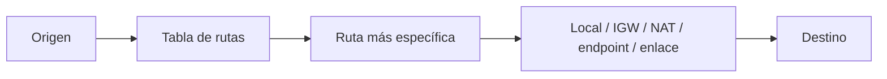
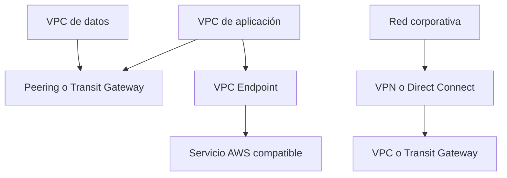
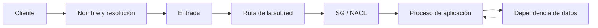

import {awsRoutingBank} from './routing-conectividad-y-seguridad-de-red-questions';

<ContentMeta area="AWS" level="intermedio" type="lección" topics={['Routing', 'Conectividad', 'Seguridad de red']} />

<KnowledgeBlock kind="check" title="Objetivo de la lección">
Seguir un flujo de red desde su origen hasta su destino y justificar el uso de
tablas de rutas, Security Groups, Network ACLs y conexiones privadas sin abrir
acceso más allá de lo necesario.
</KnowledgeBlock>

## 1. El problema: un camino permitido no es un camino completo

Que dos recursos estén dentro de la misma VPC no garantiza que puedan comunicarse.
El tráfico debe encontrar una ruta, atravesar los controles y llegar a un proceso
que escuche en el destino. Una respuesta también necesita poder regresar.

| Pregunta | Capa que se revisa |
|---|---|
| ¿A qué dirección se intenta llegar? | DNS, resolución y direccionamiento |
| ¿Por dónde debe viajar? | Tabla de rutas y gateways |
| ¿Está permitido? | Security Groups y Network ACLs |
| ¿Hay un servicio atendiendo? | Puerto, protocolo y proceso destino |

<KnowledgeBlock kind="concept" title="Routing decide el camino; los controles deciden si pasa">
Una ruta hacia un destino no concede autorización, y una regla permitida no crea
una ruta. El diagnóstico debe conservar ambas preguntas separadas.
</KnowledgeBlock>

## 2. Cómo se elige una ruta

Una tabla de rutas contiene destinos y objetivos. El router de la VPC utiliza la
ruta más específica que coincida con el destino del paquete; si no existe una
ruta aplicable, el tráfico no puede seguir ese camino.

| Elemento | Ejemplo | Significado |
|---|---|---|
| Destino | `10.0.20.0/24` | Rango al que se dirige el tráfico |
| Objetivo | `local`, NAT, IGW, endpoint o peering | Siguiente salto o conexión |
| Asociación | Subred o gateway | Dónde se aplica la tabla |
| Ruta local | Rango de la VPC | Comunicación interna de la VPC |

La ruta por defecto `0.0.0.0/0` es un último recurso para IPv4. No reemplaza
rutas específicas y no cubre automáticamente IPv6, cuyo destino equivalente es
`::/0`.
[Conceptos de tablas de rutas](https://docs.aws.amazon.com/vpc/latest/userguide/RouteTables.html)

## 3. Security Groups: control stateful de interfaces

Un **Security Group (SG)** es un firewall stateful asociado a interfaces de red.
Sus reglas son de permiso: el tráfico no permitido por una regla de entrada o
salida no pasa, y el estado de una conexión permite la respuesta correspondiente.

| Decisión | Ejemplo recomendado |
|---|---|
| Origen de entrada | SG del balanceador, no `0.0.0.0/0` |
| Puerto | Solo el puerto que necesita la capa |
| Destino | SG de la interfaz que recibe |
| Salida | Limitar cuando el flujo y la operación lo permitan |

<KnowledgeBlock kind="example" title="Cadena de grupos para tres capas">
El SG del balanceador permite HTTPS desde clientes; el SG de la aplicación permite
el puerto interno solo desde el SG del balanceador; el SG de datos permite el puerto
del motor solo desde el SG de la aplicación. Cada regla expresa una dependencia.
</KnowledgeBlock>

Referenciar otro SG puede conservar la intención del diseño cuando cambian las IP
de las instancias. No convierte la regla en una autorización para cualquier recurso
del entorno: el grupo debe estar asociado al origen correcto.
[Security Groups](https://docs.aws.amazon.com/vpc/latest/userguide/vpc-security-groups.html)

## 4. Network ACLs: filtro stateless de subred

Una **Network ACL (NACL)** se aplica a nivel de subred y evalúa reglas numeradas
de entrada y salida. Es stateless: hay que permitir explícitamente los sentidos
necesarios, incluidos los puertos efímeros que correspondan a respuestas.

| Característica | Security Group | Network ACL |
|---|---|---|
| Ámbito | Interfaz de red | Subred |
| Estado | Stateful | Stateless |
| Reglas | Permitir | Permitir o denegar, según regla |
| Uso habitual | Acceso mínimo por recurso | Barrera adicional de subred |

<KnowledgeBlock kind="caution" title="No usar una NACL como sustituto del diseño">
Una NACL demasiado restrictiva puede bloquear respuestas legítimas y producir
fallos difíciles de atribuir. Primero define el flujo y el SG; añade restricciones
de subred con una razón operativa verificable.
</KnowledgeBlock>

[Network ACLs](https://docs.aws.amazon.com/vpc/latest/userguide/vpc-network-acls.html)

## 5. Conectividad privada entre redes

Cuando el destino no está en la misma VPC, el camino puede usar distintos mecanismos.
No son intercambiables: difieren en topología, escala, operación y límites.

| Opción | Cuándo encaja | Precaución |
|---|---|---|
| VPC Peering | Conexión directa entre dos VPC | Gestionar rutas y evitar CIDR solapados |
| Transit Gateway | Muchas VPC o redes con una topología central | Diseñar asociaciones, propagación y segmentación |
| Site-to-Site VPN | Conexión cifrada sobre Internet | Revisar túneles, rutas y rendimiento |
| Direct Connect | Conectividad dedicada con una red externa | Requiere diseño y provisión adicionales |
| VPC Endpoint | Acceso privado a servicios compatibles de AWS | Elegir endpoint, políticas y rutas adecuadas |

Un endpoint puede evitar que una llamada a un servicio AWS dependa de salida a
Internet. Aun así, se deben revisar políticas del endpoint, rutas y permisos de
la identidad.
[VPC endpoints](https://docs.aws.amazon.com/vpc/latest/privatelink/vpc-endpoints.html)

## 6. Diseñar el flujo de extremo a extremo

Antes de añadir una regla, documenta un flujo concreto:

| Campo | Ejemplo |
|---|---|
| Origen | SG del balanceador |
| Destino | SG de la aplicación |
| Protocolo y puerto | TCP 8080 |
| Ruta | Subred privada → ruta local |
| Respuesta | Permisión stateful o reglas NACL de retorno |
| Evidencia | Conexión comprobada, logs o Reachability Analyzer |

<KnowledgeBlock kind="check" title="Una regla debe tener una razón">
Si no puedes explicar quién inicia el flujo, qué destino necesita, qué puerto usa,
por dónde viaja y qué evidencia demostrará su funcionamiento, todavía no hay base
suficiente para abrirlo.
</KnowledgeBlock>

## 7. Diagnóstico ordenado

Cuando un servicio no conecta, evita cambiar todas las reglas a permitir. Conserva
el flujo esperado y revisa una capa cada vez.

| Orden | Comprobación |
|---:|---|
| 1 | Nombre resuelto y dirección destino |
| 2 | Tabla de rutas de origen y destino |
| 3 | Gateway, peering, endpoint o enlace elegido |
| 4 | SG de origen, SG de destino y puerto |
| 5 | NACL de entrada y salida, incluyendo retorno |
| 6 | Proceso escuchando y protocolo correcto |
| 7 | Logs, VPC Flow Logs o Reachability Analyzer |

<KnowledgeBlock kind="example" title="El puerto está abierto, pero la conexión falla">
Si el SG permite TCP 8080 y aun así no hay conexión, verifica que la ruta llegue
a la subred correcta, que la NACL permita ida y vuelta y que la aplicación escuche
en la interfaz y puerto esperados. Una regla correcta no compensa un proceso ausente.
</KnowledgeBlock>

## 8. Errores frecuentes

<KnowledgeBlock kind="caution" title="Confusiones que aumentan la exposición">
- Abrir un SG a `0.0.0.0/0` para resolver un problema de ruta.
- Confundir una NACL stateless con el comportamiento stateful de un SG.
- Permitir el puerto correcto desde el origen equivocado.
- Revisar solo el tráfico de ida y olvidar la respuesta.
- Usar peering o VPN sin confirmar rutas de ambos lados.
- Atribuir un fallo de aplicación a la red sin comprobar el proceso destino.
</KnowledgeBlock>

<KnowledgeBlock kind="check" title="Comprobación de comprensión">
Explica cómo diagnosticarías que una aplicación privada no puede acceder a una base
de datos en otra VPC. Distingue rutas, mecanismo de conexión, SG, NACL y proceso de
la base de datos.
</KnowledgeBlock>

  <QuizWorkbench bank={awsRoutingBank} />

## Para continuar

Continúa con [DNS, balanceo y CDN](/theory/nube/aws/03-redes/03-dns-balanceo-y-cdn),
para estudiar cómo resolver nombres y distribuir tráfico hacia los servicios.
