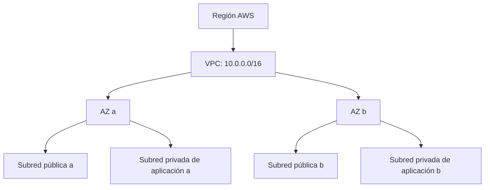
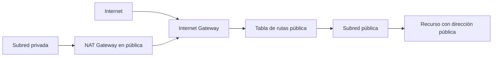
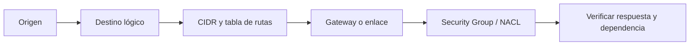

import {awsVpcBank} from './vpc-y-subredes-questions';

<ContentMeta area="AWS" level="intermedio" type="lección" topics={['VPC', 'Subredes', 'Aislamiento']} />

<KnowledgeBlock kind="check" title="Objetivo de la lección">
Explicar cómo una VPC, sus subredes y sus rutas delimitan el alcance de los recursos,
y justificar una separación básica entre componentes públicos, de aplicación y de datos.
</KnowledgeBlock>

## 1. El problema: conectar sin exponer todo

Una aplicación distribuida necesita que algunos componentes se comuniquen, pero no
que todos sean alcanzables desde cualquier red. El diseño de red debe responder,
antes de abrir puertos, tres preguntas:

| Pregunta | Decisión que orienta |
|---|---|
| ¿Qué recursos deben comunicarse? | Flujos permitidos y dependencias |
| ¿Desde dónde deben ser alcanzables? | Exposición pública, privada o aislada |
| ¿Qué ocurre si una ubicación falla? | Distribución entre zonas de disponibilidad |

<KnowledgeBlock kind="concept" title="La red no es solo una lista de recursos">
Una topología describe límites, caminos y controles. Tener una instancia dentro de
una VPC no demuestra que pueda llegar a otra instancia, a Internet o a un servicio
AWS: hay que seguir el flujo completo.
</KnowledgeBlock>

## 2. Modelo mental: VPC, subred y zona

Una **VPC** es una red virtual aislada y definida para una región. Su rango CIDR
establece las direcciones que puede contener. Una **subred** es una división de ese
rango asociada a una única zona de disponibilidad (AZ).

Las AZ aportan un límite de aislamiento dentro de una región. Crear dos subredes
con nombres distintos en la misma AZ no equivale a distribuirlas entre AZ distintas.
La VPC puede tener subredes en varias AZ, pero cada subred individual pertenece a una.
[Subredes de una VPC](https://docs.aws.amazon.com/vpc/latest/userguide/configure-subnets.html)

## 3. Rango IP y subredes

El CIDR de la VPC debe permitir las subredes actuales y las ampliaciones previsibles.
También debe evitar solaparse con redes conectadas por VPN, peering o Transit Gateway.

| Elemento | Ejemplo | Función |
|---|---|---|
| VPC | `10.0.0.0/16` | Rango general de la red |
| Subred pública a | `10.0.1.0/24` | Recursos con ruta hacia un Internet Gateway |
| Subred privada de aplicación a | `10.0.11.0/24` | Servicios internos y salida controlada |
| Subred de datos a | `10.0.21.0/24` | Bases de datos y dependencias no públicas |

Un prefijo más pequeño contiene más direcciones. No conviene elegir subredes muy
pequeñas solo porque el laboratorio actual tenga pocos recursos: el crecimiento,
las interfaces de red y la distribución por AZ pueden consumir el margen.

<KnowledgeBlock kind="caution" title="El CIDR es una decisión de conectividad futura">
Un rango que se solapa con una red corporativa o con otra VPC dificulta conectar
ambos entornos. Antes de asignarlo, inventaría las redes que deberán comunicarse,
no solo los recursos que se crearán hoy.
</KnowledgeBlock>

## 4. Qué hace pública a una subred

Pública y privada no son propiedades visuales del nombre de la subred. Una subred
es pública cuando su tabla de rutas tiene un camino hacia un Internet Gateway; un
recurso necesita además una dirección y reglas compatibles para ser alcanzable.

| Pieza | Pregunta que responde |
|---|---|
| Tabla de rutas | ¿A qué destino se envía el tráfico? |
| Internet Gateway | ¿Puede la VPC conectarse con Internet? |
| Dirección pública o Elastic IP | ¿Puede identificarse el recurso desde Internet? |
| Security Group y NACL | ¿Se permite el tráfico en las capas de control? |

La ruta `0.0.0.0/0` representa destinos IPv4 que no coinciden con una ruta más
específica. No es por sí sola un permiso de entrada: indica el siguiente salto;
los controles de tráfico y la configuración del recurso siguen siendo necesarios.
[Tablas de rutas de subred](https://docs.aws.amazon.com/vpc/latest/userguide/subnet-route-tables.html)

## 5. Salida privada y dependencias

Una subred privada puede necesitar descargar actualizaciones o llamar a una API
externa sin aceptar conexiones iniciadas desde Internet. En ese caso, un NAT
Gateway en una subred pública puede traducir la salida hacia el Internet Gateway.

| Patrón | Entrada iniciada desde Internet | Salida hacia Internet |
|---|---:|---:|
| Subred pública con IGW | Posible si dirección y reglas lo permiten | Sí |
| Subred privada con NAT Gateway | No por el NAT | Sí, iniciada desde dentro |
| Subred aislada | No | No, salvo rutas privadas específicas |

<KnowledgeBlock kind="example" title="Aplicación privada con salida controlada">
Un servicio de aplicación en una subred privada necesita descargar una dependencia.
Su ruta por defecto apunta al NAT Gateway de la subred pública; el NAT permite la
salida, pero no convierte al servicio en un destino público para conexiones nuevas.
La disponibilidad de esa salida y su coste también forman parte del diseño.
</KnowledgeBlock>

AWS recomienda NAT Gateway frente a administrar una instancia NAT cuando se busca
menos operación propia; aun así, hay que evaluar coste, rutas y redundancia por AZ.
[Dispositivos NAT](https://docs.aws.amazon.com/vpc/latest/userguide/vpc-nat.html)

## 6. Distribuir capas y zonas

Una topología inicial suele separar exposición, aplicación y datos. La separación
reduce la superficie de exposición, pero no crea disponibilidad automáticamente.

| Capa | Ubicación habitual | Acceso esperado |
|---|---|---|
| Entrada | Subredes públicas en varias AZ | Desde clientes permitidos |
| Aplicación | Subredes privadas en varias AZ | Desde la entrada y dependencias necesarias |
| Datos | Subredes privadas o aisladas | Desde la aplicación, con puertos mínimos |

<KnowledgeBlock kind="concept" title="Aislamiento y disponibilidad son decisiones distintas">
Una subred privada reduce exposición directa; distribuir una capa entre varias AZ
reduce el impacto de perder una zona. Ambas decisiones se complementan, pero ninguna
garantiza por sí sola que la aplicación pueda continuar.
</KnowledgeBlock>

## 7. Diseñar un flujo antes de crear reglas

Para cada comunicación documenta origen, destino, protocolo, puerto, ruta y control.

| Flujo | Diseño mínimo |
|---|---|
| Cliente → entrada | HTTPS hacia el punto público de entrada |
| Entrada → aplicación | Puerto de aplicación solo desde el grupo de entrada |
| Aplicación → datos | Puerto del motor solo desde el grupo de aplicación |
| Aplicación → Internet | Ruta al NAT solo si la dependencia lo requiere |

## 8. Errores frecuentes y diagnóstico

<KnowledgeBlock kind="caution" title="Confusiones que producen falsos diagnósticos">
- Confundir una ruta con una autorización.
- Llamar privada a una subred que tiene ruta directa al Internet Gateway.
- Colocar un NAT Gateway en una subred privada y esperar que funcione como salida.
- Abrir una regla a `0.0.0.0/0` cuando solo se necesitaba un origen concreto.
- Distribuir recursos entre subredes de una sola AZ y asumir tolerancia a fallos.
</KnowledgeBlock>

Para diagnosticar, sigue el flujo desde el origen: resolución de nombre, dirección,
tabla de rutas, gateway, controles de seguridad, escucha del destino y respuesta.
Reachability Analyzer y los registros de flujo pueden aportar evidencia, pero no
sustituyen la revisión del diseño.
[Reachability Analyzer](https://docs.aws.amazon.com/vpc/latest/reachability/what-is-reachability-analyzer.html)

<KnowledgeBlock kind="check" title="Comprobación de comprensión">
Explica por qué una API en una subred privada puede llamar a un servicio externo,
pero no debería aceptar conexiones iniciadas desde Internet. Incluye la ruta, el
gateway y los controles que revisarías.
</KnowledgeBlock>

  <QuizWorkbench bank={awsVpcBank} />

## Para continuar

Continúa con [Routing, conectividad y seguridad de red](/theory/nube/aws/03-redes/02-routing-y-seguridad),
donde se profundiza en tablas de rutas y controles de tráfico.
